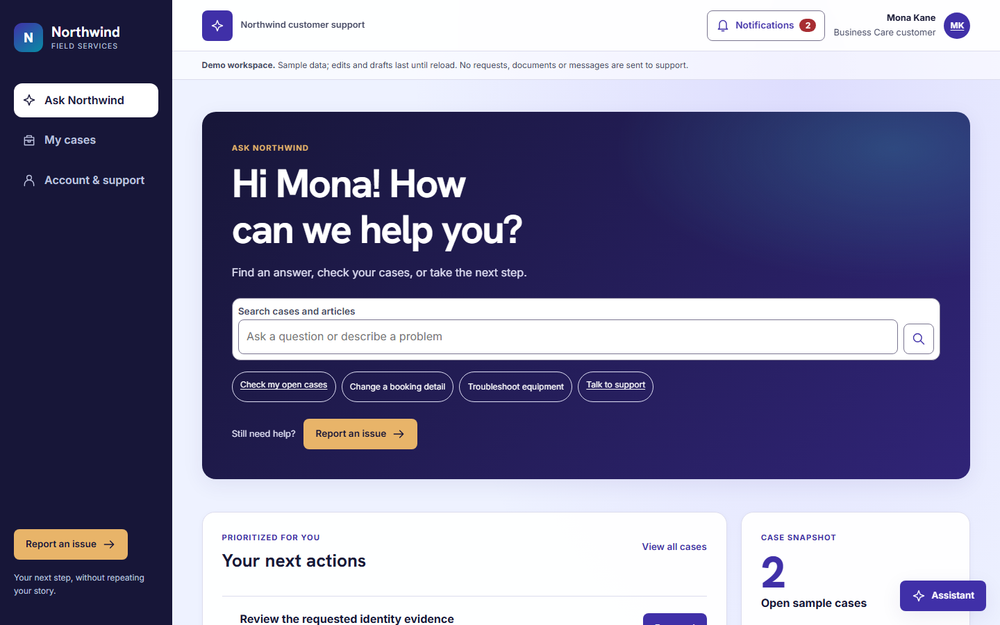

# Modern CSS Template — Northwind Customer Support

A React + Vite Power Pages code site (SPA) for customer support, branded with the fictional **Northwind Field Services** sample identity. Signed-in customers track their personal cases, reply to support and share files; everyone can browse published knowledge, with an optional AI-generated answer grounded only in knowledge articles. Case and reply updates arrive as in-app notifications, and new portal cases can be handed to the Dynamics 365 **Case Management Agent**, whose staff-approved replies are published back to the case conversation.



| Folder | Contents |
| --- | --- |
| `react/` (this folder) | Site source, Power Pages metadata (`.powerpages-site`), tests, the case-management flow definitions and the Send approval plug-in source. |
| [`../solution/`](../solution/) | The unpacked, unmanaged **ModernCSSMetadata** solution with the Dataverse customizations the site depends on. See [Template solution](#template-solution-moderncssmetadata). |

## Prerequisites

- Node.js 20 or newer and npm.
- [Power Platform CLI](https://aka.ms/PowerPlatformCLI) (`pac`) to upload the code site and import the solution.
- A Dataverse environment with Power Pages and **Dynamics 365 Customer Service** (cases, knowledge articles, Portal Comments).
- For the agent integration: the **Case Management Agent** (Case Management Intelligence) and an approved outgoing mailbox.
- For AI knowledge search: Dataverse search and Power Pages generative AI site search allowed for the environment.

## Run locally

```powershell
npm ci
npm run dev -- --host 127.0.0.1
```

Open the URL printed by Vite. To create and preview the production bundle:

```powershell
npm run build
npm run preview -- --host 127.0.0.1
```

The build writes static files to `dist`. Inter, Hanken Grotesk, and the Arabic fallback load from Google Fonts, so an internet connection is needed for those fonts.

### Data modes

| Mode | Selection | Behavior |
| --- | --- | --- |
| Demo | Default `npm run dev` | Sample records and tab-local edits; no uploads or backend writes. |
| Dataverse | Default production build | Requires the deployed endpoints, table permissions and an authenticated Power Pages session on the same origin. |
| Local integration testing | Open a dev URL with `?data=dataverse` | Uses real client code; browser tests mock the portal endpoints. Loopback alone cannot provide a portal login. |
| Explicit override | `VITE_SUPPORT_MODE=demo` or `dataverse` | Build/start-time override; other values are rejected. |

For an offline demonstration bundle in PowerShell:

```powershell
$env:VITE_SUPPORT_MODE = "demo"
npm run build
Remove-Item Env:\VITE_SUPPORT_MODE
```

Rebuild without that override before deploying the connected version. A failed connected request shows an error or sign-in state, never sample records. No Dataverse bearer token, PAC credential or account password belongs in frontend configuration.

## Experience and routes

| Route | Experience |
| --- | --- |
| `/` | Signed in: greeting hero with unified case/article search (grouped Cases and Support articles menu), Ask assistant and Report an issue actions, next actions, case snapshot, knowledge categories, bookmarks, and support shortcuts. Signed out (anonymous portal session): welcome hero with an articles-only search (Enter or **View matching support articles** filters the library; a `KA-…` number opens that article), **Still need help? Sign in to continue**, the support library and shortcuts. Signed-out visitors load only published knowledge through `northwind-knowledge`; no case, profile, catalog or AI Search Summary data is requested. If anonymous knowledge is unavailable (for example while the site is private), the hero shows only the sign-in card. |
| `/?id=<articleGUID>` | Knowledge citation entry point: waits for the complete authorized catalogue, then replaces this history entry with `/articles/:id`. |
| `/cases` | Personal cases, filters and case submission; demo mode uses fixtures and local drafts. |
| `/cases/:id` | Customer-visible conversation, request details, file upload/download and keyboard-operable tabs. Connected URLs use Dataverse GUIDs. |
| `/articles/:id` | Published external knowledge as inert plain text, tab-local bookmarks and persisted helpfulness feedback. |
| `/account` | Own name/phone updates, read-only email/account information and a persisted support-contact request. Unsupported coverage/equipment/orders are explicitly not connected. |
| Unrecognized routes or record IDs | Accessible not-found states with working navigation. |

The shell has no top bar. The sidebar holds navigation, **Notifications** with the unread count, **Sign out** (`/Account/Login/LogOff`) or **Sign in** (`/SignIn?returnUrl=…`), and an outline **Report an issue**. My cases, Account & support, notifications and the assistant appear only to signed-in customers. The initial profile check treats HTTP 401, and also HTTP 403 (returned on a private site to visitors who passed the Microsoft Entra gate without a portal sign-in), as signed out; a 403 later in a session remains an access error. Narrow screens use a slim bar with the menu and notifications. In demo mode, Sign in/Sign out simulate the portal session locally through a profile picker; nothing is collected or sent.

The incident status reason (`statuscode`) drives the state shown on case cards, filters, the case header, progress steps and the next-step panel: Waiting for Details → **Action needed** (with **Respond**, which focuses the reply form); Researching → **Support is investigating**; On Hold; In Progress; Problem Solved/Information Provided → **Resolved**; Cancelled; and Merged. The timeline lists portal-comment replies from support and the customer, plus **Case submitted** (`createdon`) and closure (`modifiedon`) entries, newest first, with **Everything / Actions taken / Communications** filters.

The three sample case IDs are `CAS-01000-M8J4J8`, `CAS-01001-S9D5F3`, and `CAS-00982-R4T7X1`. Article IDs are `KA-0182`, `KA-0214`, `KA-0341`, `KA-0408`, `KA-0430`, and `KA-0362`. Those fixture IDs are available only in demo mode.

The **Northwind Assistant** is a floating widget (minimized to an **Assistant** button by default on narrow screens) that expands into a non-modal panel that stays open across navigation. It performs rule-based matching against the current mode's case/article records, lists cases and articles as resource cards, offers **Did this resolve the issue?** after the demo gateway guide, and turns an unresolved concern into an inline ticket review that uses the same case-creation flow as **Report an issue**. **Contact support** transfers entered context to the support-contact form. It does not call an AI service. Uploads accept PDF, PNG or JPEG up to 5 MiB (5,242,880 bytes); demo file selection records metadata only.

Bookmarks and preferences remain tab-local. Saving a contact request creates feedback, not email, chat, a staff notification or a callback booking. Product/category catalogs do not prove equipment ownership, service coverage or order history.

## In-app case and support-reply notifications

When the Power Pages client API is available, the signed-in workspace uses `Microsoft.PowerPages.onPagesClientApiReady` and subscribes separately to the logical tables `incident` and `adx_portalcomment` with `$pages.data.subscribeToChanges` (falling back to `$pages.realtime.subscribe` on earlier client API builds). Cleanup calls each returned handle's `unsubscribe()`. Enable the site's realtime data-change feature (the `RealtimeNotifications/Enabled` site setting) for these events.

Events are treated only as invalidations: the app reloads the paginated, contact-filtered case list and validates ownership before displaying changes. For Portal Comment invalidations, it reads the authorized conversation of each listed case, with at most three concurrent reads. It never renders event payloads, fetches event-supplied record IDs, queries the raw Portal Comment Web API, or manages realtime grants or tokens. A support reply is a customer-visible Portal Comment with direction `2`; reply detection does not rely on the parent case's modified time.

Initial case records and the first conversation snapshot for each case are silent baselines. Changed known cases produce one latest case notification per case; new or edited Support comments produce a separate support-reply notification, even when the case itself is unchanged. Customer comments never generate support-reply alerts. The bell offers mark-read, mark-all-read, dismiss and open-case actions; reply links open the case conversation. Duplicate or reconnect invalidations with unchanged records do not notify again. Cases that are no longer accessible are removed from the list and bell. Failed refreshes show an error and retry action; authentication or access failures clear private case data. There is no polling fallback.

**Case status and lifecycle updates** and **Replies from support** in Account & support independently control new alerts. Notifications and preferences exist only in the current tab: there is no browser/OS push, email or cross-session delivery. Without the client API, normal support workflows continue and the bell explains that live updates are unavailable. Open conversations refresh without losing the active tab or unsaved reply/edit drafts. Whether changes made outside the portal (for example by agents in Dynamics 365) raise events depends on the environment's realtime support; customers can always refresh the case.

## AI knowledge search (preview)

**Default-off build gate:** `VITE_KB_AI_SEARCH_ENABLED` must equal the exact string `true` at build or dev-server startup for the connected search surface to request a summary. Unset, empty, `false` and all other values keep it off. A default build sends **no Search Summary request**, shows a setup-unavailable notice on search submission, and keeps ordinary case/article keyword matches. Demo mode never calls AI. The gate is rollout protection, not a substitute for server-side knowledge scoping.

When enabled, submitting the main support search requests an AI answer above the keyword matches. Typing alone never calls AI, and the request contains only the entered query. `src/services/aiSummaryService.ts` posts a form-encoded `userQuery` to `/_api/search/v1.0/summary` with the CSRF token, distinguishes disabled/auth/network/service/malformed/empty outcomes, and verifies every citation against the complete authorized article catalogue. Only same-origin knowledge routes are accepted: Home `/?id=<guid>`, `/page-not-found/?id=<guid>`, `/articles/<guid>`, or classic `/knowledgebase/article/KA-...`. Unknown, foreign, case, duplicate or contradictory sources suppress the entire answer. AI output is rendered as text plus validated citation links, never HTML. Query edits, cancellation and unmount invalidate earlier requests. An HTTP 200 `{Code:400,Message:"Gen AI Search is disabled."}` shows governance remediation rather than an empty answer.

Site configuration (in `.powerpages-site/site-settings` and the template solution):

- `Search/EnableGenerativeAI = true`, `Search/Enabled = true`, and `search/query` cleared to an empty value, as [required for generative AI search](https://learn.microsoft.com/power-pages/configure/search/generative-ai).
- `Search/IndexQueryName` names the dedicated **Northwind KB Search** view on `knowledgearticle`, shipped in the [template solution](#template-solution-moderncssmetadata). The view limits search to published, external, non-root articles in the configured language within their publication/expiry window. Keep the setting and the view name identical.
- `Search/FacetedView = false`, matching the generative search limitation.
- The `knowledgearticle_SearchResultPage` site marker targets Home, so citations open in the SPA. Do not point the reserved **Knowledge Article** marker at the SPA Home page; that hands Home to native knowledge-page handling.

Enable Dataverse search for the environment and allow generative AI site search in governance: tenant AI governance overrides Copilot Hub environment/site access, which overrides the maker toggle at **Set up workspace → Copilot → Site search (preview)**. If you use the **Refine your data** wizard, compare the shared `Portal Search` views before and after; it can change shared views rather than create a site-specific source. Only one version of an article is published at a time ([Manage knowledge article versions](https://learn.microsoft.com/dynamics365/customer-service/use/ka-versions)), so the view relies on the published state rather than a newest-version filter.

Citation validation in the browser is defense in depth, **not** a retrieval or authorization boundary. Do not enable case grounding, broaden table permissions or enable the raw knowledge Web API for this feature.

> **Note**
>
> AI summarization APIs are a preview feature. Preview features aren't meant for production use and may have restricted functionality.

## Dataverse contract and access

The site uses nine existing Dynamics 365 tables. It creates no new customer-data tables, authentication providers or external secrets.

| Table | Authenticated Users access | Purpose |
| --- | --- | --- |
| `contact` | Self: Read, Write, Append, Append To | Own first/last name and phone, and linking the signed-in Contact to a case; identity, email, account membership and security fields are not accepted as edits. |
| `account` | Contact via `contact_customer_accounts`: Read | Only the account associated with the signed-in contact. |
| `incident` | Contact via `incident_customer_contacts`: Read, Create, Write, Append, Append To | Contact-as-customer cases only; no account-wide or extra primary-contact access. |
| `adx_portalcomment` | Parent personal case via `incident_adx_portalcomments`: Read, Create, Append | Portal conversation, not email or the general CRM activity timeline. |
| `annotation` | Parent personal case via `Incident_Annotation`: Read, Create, Append | Portal-designated case files, not arbitrary internal notes. |
| `knowledgearticle` | Global: Read, Append To | Server-filtered external published content; raw Web API disabled. |
| `product` | Global: Read, Append, Append To | Read-only choices with relationship linking for an optional case product. |
| `category` | Global: Read | Read-only catalog. |
| `feedback` | Global: Create, Append | Server-bound author and eligible article reference; no customer reads or edits. |

There are no Delete grants or anonymous customer-data grants. The only anonymous grant is **Northwind - Anonymous published knowledge**: Global Read on `knowledgearticle` for the Anonymous Users role, used by `northwind-knowledge` and site search, both of which return only published, external, non-root articles in the configured language. Anonymous Users is also assigned to the `northwind-knowledge` Server Logic; every other handler stays authenticated-only. On a private site, visitors who passed the Entra gate without a portal sign-in don't get the Anonymous Users role, so anonymous article search works only on a public site. Both Web API and Server Logic respect table permissions. Raw Web API remains disabled for contact, account, knowledge, feedback, identity and internal-activity tables; only personal cases and the `product` (`productid,name,statecode`) and `category` (`categoryid,title`) catalogs are enabled, with no wildcard field lists.

The case field allowlist is `_customerid_value,caseorigincode,createdon,customerid_contact,description,incidentid,modifiedon,productid,statecode,statuscode,ticketnumber,title`. The **Case API** column-permission profile is assigned only to Authenticated Users: default Read, with Create + Read overrides for `title`, `description`, `caseorigincode`, `customerid_contact` and `productid`, and no Update. These settings block direct status/number/ID writes and customer reassignment through the Web API, while guarded Server Logic handles case edits. Keep enhanced authorization disabled (`0`): classic column permissions apply to Web API, not Server Logic. Self Contact and Product permissions need **Append** as well as Append To for native case creation, and the customer column override must name the polymorphic navigation property **`customerid_contact`**, not `customerid`.

| Endpoint (relative to your site URL) | Methods | Contract |
| --- | --- | --- |
| `/_api/serverlogics/northwind-profile` | GET, PATCH | Own profile and related account; allowlisted name/phone edits. |
| `/_api/incidents` | GET, POST | Paginated personal cases and native case creation with the authenticated profile's Contact binding. |
| `/_api/incidents(<guid>)` | GET | Fetch the saved case and ticket number after a successful create. |
| `/_api/serverlogics/northwind-cases` | PATCH | Active, owned-case title/description edits. |
| `/_api/serverlogics/northwind-knowledge` | GET | Published external knowledge, including publication/expiry and eligible-version checks. Available to anonymous and signed-in visitors. |
| `/_api/serverlogics/northwind-case-activity` | GET, POST | Case-authorized portal conversation, document creation and individually authorized downloads. |
| `/_api/serverlogics/northwind-feedback` | POST | Article helpfulness or a contact request with server-owned authorship. |

Server Logic returns a normalized `{status:"success",data:...}` or `{status:"error",code,message}` inside Power Pages' execution envelope; native Web API reads return Dataverse fields and `@odata.nextLink`. The shared client handles both contracts, uses cookie authentication and supplies `__RequestVerificationToken` from `/_layout/tokenhtml` on all requests. It rejects malformed DTOs and invalid pagination rather than substituting data.

Case POST sends only the derived title, description including business impact, `caseorigincode: 3` (Web), `customerid_contact@odata.bind` from the authenticated profile, and optional `productid@odata.bind`. Dataverse supplies status, ownership, IDs and ticket numbers. The client accepts an empty 204, reads the GUID from the `entityid` or `OData-EntityId` header, then fetches and validates that exact case before showing success. Uncertain outcomes preserve the draft and ask the customer to reload cases rather than retrying automatically.

Knowledge language is set by the `Northwind/KnowledgeLanguageLocaleId` site setting. **Replace its value** with the ID of your environment's `languagelocale` record for the knowledge language (en-US/1033 in the template); the shipped value belongs to the source environment.

Files must have a note description (`annotation.notetext`) beginning with the standard `*WEB*` marker. Portal comments use the same gateway convention: `adx_portalcomment.subject` must begin with `*WEB*` and have a valid Incoming/Outgoing direction. New customer comments receive the marker server-side; unmarked comments stay hidden, so staff replies are published deliberately (see [Publish an approved response](#publish-an-approved-response)).

The schema limits case descriptions and feedback messages to 2,000 characters (new cases include the selected business impact within that limit), case titles to 200, profile fields to 50 each and customer replies to 4,000. The site is English (`en-US`, LTR); logical CSS, isolated inserted text, adaptive free-form controls and locale-aware formatting support future localization.

### Server Logic authoring notes

- The hosted validator rejects anonymous `function (...)` callbacks anywhere in a Server Logic file (`RTSL01: prohibited pattern`). Use arrow callbacks; `tests/server-logic.test.cjs` checks this pattern and the `with` restriction across all five handlers.
- The Dataverse connector returns a **JSON string**, not an object. Every handler decodes string responses before reading status, headers or body.
- A newly uploaded script can take a short time to replace the cached version; refresh rather than changing permissions.

## Source structure

| Location | Responsibility |
| --- | --- |
| `src/pages` | The five routed page types. |
| `src/components` | Layout/sidebar shell, native dialogs, fields, search, icons, the Northwind Assistant widget/panel, sign-in/sign-out controls (with the demo-only profile picker), and issue drafting. |
| `src/SupportContext.tsx` | Data mode, authenticated loading, DTO mapping, mutations, notifications and tab-local preferences/bookmarks. |
| `src/useCaseRealtime.ts` | Client API change subscriptions for cases and portal comments. |
| `src/services/supportApi.ts` | Shared CSRF-aware typed service, pagination, DTO validation and file transport. |
| `src/services/aiSummaryService.ts`, `src/hooks/useSearchSummary.ts` | Search Summary transport, guarded decoding, knowledge-only citation validation, and cancellable explicit-submit state. |
| `src/data.ts` | Sample records, search, and `Intl` formatting helpers. |
| `src/styles/theme.css` | Shared tokens, responsive layouts, interaction states, logical positioning, and reduced-motion behavior. |
| `tests/*.spec.ts` | Playwright desktop/narrow scenarios: demo behavior, mocked connected workflows, AI search and realtime notifications. |
| `tests/server-logic.test.cjs`, `tests/permissions.test.cjs`, `tests/case-management-flow.test.cjs` | Server Logic contract tests, metadata guardrails and flow-definition checks; not hosted verification. |
| `integrations/case-management/flow.json`, `publish-response-flow.json` | Case Management Agent dispatch flow and the Send-approval publishing flow (also shipped in the template solution). |
| `integrations/case-management/send-approval-plugin/` | Native Send PreValidation plug-in source, build/registration guidance and executable checks. |
| `.powerpages-site/` | Server Logic, table permissions, column permissions, web roles, site settings and other site metadata for `pac pages upload-code-site`. |
| `docs/customer-request-flow.md` | Customer request flow and key entities, including the independent email and portal paths after Send approval. |

## Tests

```powershell
npm test
npm run test:server
```

The Playwright configuration uses installed Microsoft Edge and starts or reuses the loopback Vite server. Set `$env:PLAYWRIGHT_CHANNEL = "chrome"` to use Chrome, and `$env:PLAYWRIGHT_PORT` to an unused port to avoid reusing another project's server. AI search tests that need the build gate run only when `VITE_KB_AI_SEARCH_ENABLED=true`:

```powershell
$env:PLAYWRIGHT_PORT = "5187"
$env:VITE_KB_AI_SEARCH_ENABLED = "true"
npx playwright test ai-search.spec.ts connected-support.spec.ts
Remove-Item Env:\VITE_KB_AI_SEARCH_ENABLED, Env:\PLAYWRIGHT_PORT
```

Demo tests reject unexpected writes. Connected tests mock same-origin portal responses and exercise success, failure and CSRF-protected writes. Server tests run the handlers against a mocked SDK. These checks cannot certify Power Pages runtime authorization.

## Case Management Agent integration

The **Northwind - Case Management Agent (review required)** cloud flow runs when Dataverse adds an active `incident` with `caseorigincode = 3` (Web) created by the site's application user (`ppst_ModernCss_PortalApplicationUserId`). Web origin alone is not the boundary: cases created by other applications are excluded. Portal case creation uses `/_api/incidents` and doesn't wait for agent processing.

The flow re-reads the case, checks its scope and calls `msdyn_GetCaseManagementAgentSettings`. Dispatch is blocked unless the effective resolution configuration is enabled and **Semi** (human review). It then creates an internal note whose ID equals the case ID, calls `msdyn_invokeCaseProcessingAgent`, and records whether dispatch was accepted. The deterministic note stops a duplicate delivery or resubmission from dispatching the same case twice. Agent invocation has no automatic retries; a successful 204 means the request was accepted, not that the case was resolved.

Configure the agent per environment: a business line set to **Require agent confirmation**, AI-eligible guidance intents mapped to your published external knowledge articles, and case/email routing rules that select that business line for Web cases created by the site's application user. Unknown intents can hand off to a representative rather than inventing a resolution. Keep the flow's effective-mode gate: the managed request processor can apply the matched business line's mode instead of a requested `automationLevel`, so the request parameter alone doesn't guarantee review.

Agent responses remain **Dynamics 365 email drafts**. A representative reviews the draft, its sender and recipient, then uses **Send**; the published response then appears on the portal. The portal doesn't expose internal drafts or retrigger the agent on portal comments. See [Case Management Agent setup](https://learn.microsoft.com/dynamics365/customer-service/administer/set-up-case-resolution-agent) and the [custom trigger API](https://learn.microsoft.com/dynamics365/customer-service/develop/use-case-processing-agent).

### Template solution (ModernCSSMetadata)

The site itself is rebuilt from this folder (with the Power Pages skills or `pac pages upload-code-site`), and target environments already have the Dynamics 365 Customer Service solutions. The unmanaged **ModernCSSMetadata** solution in [`../solution/`](../solution/) (publisher **Power Pages SPA Templates**, prefix `ppst`) carries only the Dataverse customizations the site depends on that neither provides:

| Component | Purpose |
| --- | --- |
| Cloud flow **Northwind - Case Management Agent (review required)** | Dispatches portal-created Web cases to the Case Management Agent in Semi mode. |
| Cloud flow **Northwind - Publish reviewed response to portal** | Publishes the Send-approved reply as a customer-visible Portal Comment. |
| Connection reference `cr719_northwindportalresponseconversion` (Content Conversion) | HTML-to-text conversion in the publish flow. |
| Plug-in assembly `Northwind.SendApproval` 1.0.1.0 and its **Send**/`email` PreValidation step | Captures the reviewed reply snapshot on native Send. |
| System view **Northwind KB Search …** on `knowledgearticle` | Knowledge-only scope for AI search; `Search/IndexQueryName` must name it. The solution includes `knowledgearticle` only as the view's container. |
| Environment variables `ppst_ModernCss_PortalApplicationUserId`, `ppst_ModernCss_PortalUrl`, `ppst_ModernCss_ApprovalWriterUserId` | The site's application-user ID, the site URL, and the environment's SYSTEM user ID. |

The solution ships without environment-variable values, so import asks for them. The plug-in reads the portal-user variable (current value, then default value) and falls back to optional step configuration; the step ships without configuration. Both flows also use the Dataverse connection reference provided by Case Management Intelligence (`msdyn_CustomerServiceCaseClosureFollowup.shared_commondataserviceforapps.msdyn_sharedcommondataserviceforapps`). Import requires **PowerPages_RuntimeCore** (Portal Comment), **msdynce_Service** (Case), **msdyn_CaseManagementIntelligence** and **msdyn_KBSuggestionsAiBCore** (Knowledge Article) in the target.

Not included, because they are environment content or settings: site components, the agent's business line, intents and article mappings, routing rules, knowledge articles, Dataverse search, Power Pages generative AI governance and the `.js` attachment allowance.

### Set up a new environment

1. Build and upload the site from this folder (see [Deploy to Power Pages](#deploy-to-power-pages)). Uploading creates the site and its **Portals-&lt;site name&gt;** application user.
2. Update environment-specific site settings, such as `Northwind/KnowledgeLanguageLocaleId`, and publish your external knowledge articles.
3. Zip the contents of [`../solution/`](../solution/) so `solution.xml`, `customizations.xml` and `[Content_Types].xml` are at the root of the archive (for example `Compress-Archive -Path ..\solution\* -DestinationPath ModernCSSMetadata.zip`), then import it with `pac solution import --path ModernCSSMetadata.zip` or in Power Apps. Enter the site's application-user ID, the site URL and the environment's SYSTEM user ID for the three environment variables, and bind the Content Conversion and Dataverse connection references.
4. Configure the Case Management Agent business line, intents and routing rules in **Require agent confirmation** mode.
5. Enable Dataverse search and generative AI site search if you build with `VITE_KB_AI_SEARCH_ENABLED=true`.
6. Configure an approved outgoing mailbox for support replies.

### Publish an approved response

The **Northwind - Publish reviewed response to portal** flow consumes native Send approvals. No email IDs need copying, and there is no extra approval step.

1. Open the outgoing case email in Dynamics 365. Review and edit the complete body, including quoted history, signatures and any agent-generated guidance.
2. Confirm **Regarding** is the customer's portal case and the only **To** recipient is that case's Contact. Select an approved outgoing **From** mailbox and honor the Contact's communication preferences.
3. Use the normal **Send** button. The plug-in records the reviewed snapshot, then Dynamics continues its own email processing. Neither the plug-in nor the flow sends an additional email.
4. The flow posts the approved snapshot independently. Even if Dynamics reports an email-send error and leaves the email in Draft, the portal response can still publish. The customer sees it as **Support** in the case conversation.

The plug-in is a synchronous **PreValidation** step on the native **Send** message for **email** (Web API action `SendEmail`). It recognizes `IssueSend: true`; ordinary Save/AutoSave, status edits and `IssueSend: false` do not approve publication. Eligible responses concern a portal-created Web case with a Contact customer and exactly that Contact as the sole To recipient. The initiating user must be able to read the case and read/write the email.

The plug-in creates a SYSTEM-authored internal `annotation` containing the base64-encoded reviewed HTML, email version, case, Contact, reviewer and timestamp. It requires execution **outside a parent transaction**, so later Send validation or delivery failure cannot undo the approval; transactional Send contexts are rejected. The flow listens for added notes with the exact approval marker and SYSTEM creator, verifies provenance, rechecks the case's portal origin and Contact, and **never reads email delivery status or the email's current body**. Content Conversion produces plain text with a **1-4,000 character** limit and no truncation. Email attachments and embedded images are not copied.

The new `adx_portalcomment` uses subject `*WEB* Reviewed support response`, outgoing direction `2`, and the approved case. A publication receipt, an internal note keyed by email ID, ensures only one response is published per email; repeated approvals return `AlreadyPublished`. Use a **new email** for a distinct follow-up. Portal publication and email delivery have separate outcomes: don't resend email merely to retry publication, and inspect any reserved comment and prior run before recovery.

To test without delivering mail, send a synthetic reply to a test Contact with an `example.invalid` address and **Do not email** enabled: Dynamics rejects the send natively while the flow still publishes the reviewed snapshot. See [Content Conversion limitations](https://learn.microsoft.com/connectors/conversionservice/) and [plug-in transaction behavior](https://learn.microsoft.com/power-apps/developer/data-platform/scalable-customization-design/database-transactions).

## Replace demonstration content before launch

The three `SAMPLE CONTENT` markers in `src/data.ts` identify customer/coverage/equipment, cases/history/response expectations, and knowledge articles. Also replace the sample contacts, plan dates/terms, equipment serials, orders and service targets in `src/pages/Account.tsx`; notification examples in `src/SupportContext.tsx`; and the Northwind identity and copy throughout the UI. All article instructions and policies require product-owner approval.

Before accepting real customer data, approve the preview Server Logic dependency, confirm consent, retention, attachment scanning and delivery policies, and validate the integration on the target site. File signature checks are not malware scanning. The 5 MiB file contract must also pass the portal's request-size, timeout and Dataverse attachment limits.

## Deploy to Power Pages

`powerpages.config.json` names the site, the `dist` build output and the `index.html` landing page. Build the connected version and upload it with PAC:

```powershell
npm run build
pac pages upload-code-site --rootPath .
```

Add `$env:VITE_KB_AI_SEARCH_ENABLED = "true"` before the build to turn on AI search. Always use `pac pages upload-code-site`, never `pac pages upload`. The environment must allow `.js` attachments.

After each upload, confirm every column-permission override under the **Case API** profile exists; if PAC omits one, add it through Portal Management or the Dataverse API rather than broadening default column permissions. On Windows, keep the project path short: deep paths can exceed metadata path limits during upload.
