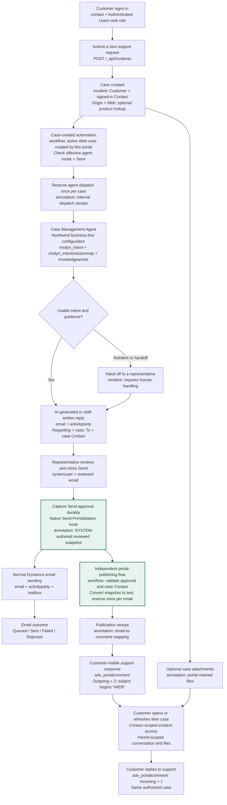

# Northwind customer request flow

The native **Send action** creates a durable reviewed snapshot before mail validation. Portal publication and email delivery follow separate paths; a rejected, queued or failed email does not block the approved portal response.

There is deliberately **no arrow from email outcome to portal publication**. The captured approval survives immediate mail rejection because it is committed outside the mail transaction. Publishing to the portal does not send or retry email. A valid native Send request must reach the server; ordinary Save/AutoSave and browser validation that prevents Send are not approval events.

## Key entities by step

| Step | Key entity or configuration | Role |
|---|---|---|
| Customer identity | `contact`; web role | Identifies the signed-in customer and grants authenticated portal access. |
| Request creation | `incident`; optional `product`; portal application `systemuser` | Stores the request, Contact customer, Web origin, product association and creation provenance. |
| Customer files | `annotation` | Stores portal-designated attachments linked to the authorized case. This is separate from internal automation notes. |
| Automation | `workflow` | Defines the case-created automation and response-publishing cloud flow. |
| Agent dispatch | Internal `annotation` | Records dispatch and prevents repeated agent invocation for the same case. |
| Agent guidance | Business-line configuration; `msdyn_intent`; `msdyn_intentsolutionmap`; `knowledgearticle` | Selects supported guidance and enforces human-review mode. No matching intent can lead to human handoff rather than a draft. |
| Reviewed response | `email`; `activityparty`; staff `systemuser` | Holds the response and its sender/recipient relationships. The sole To recipient must be the case's Contact. |
| Native Send hook | `pluginassembly`; `plugintype`; `sdkmessageprocessingstep` | Registers scoped, synchronous PreValidation processing on `Send` for `email`; checks caller access and requires a non-transactional context. |
| Send approval | Separate SYSTEM-authored `annotation` request | Captures reviewed HTML, source version, case, Contact, reviewer and timestamp before mail outcome is known. It survives a rejected send. |
| Email delivery | `email`; `activityparty`; `mailbox` | Handles normal email transport and its own status. It must not determine whether the approved portal response is published. |
| Publication tracking | Internal `annotation` receipt | Reserves one publication per source email and records its separate portal-comment ID. Existing published snapshots remain immutable. |
| Portal conversation | `adx_portalcomment` linked to `incident` | Stores outgoing Support responses and incoming customer replies. |

## Boundaries retained

- Customers see only cases whose Customer is their signed-in Contact, and the permitted comments/files under those cases. Internal dispatch, approval and publication notes are not customer-visible.
- Raw Email and Portal Comment Web APIs remain disabled. Case activity is read through the existing ownership-checking Server Logic endpoint.
- Ordinary draft Save, AutoSave and record-only `IssueSend: false` do not authorize publication. The scoped native `IssueSend: true` request captures approval; it is not an independent audit that a human read the response.
- The consumer accepts only SYSTEM-authored approval requests and rechecks the approved case's current Contact. A draft edit after rejected Send cannot replace the captured text.
- The current publication contract is plain text, 1-4,000 converted characters, without silent truncation. Email attachments are not automatically copied into portal files.
- The email and portal comment use different activity IDs. Repeated Send actions must not duplicate an already published response.
- Editing a case or adding a customer reply does not automatically invoke the case-created agent flow again.
- Neither agent handoff nor clicking Send implies the case is resolved. Case status remains separately managed.

See the [template solution](../README.md#template-solution-moderncssmetadata), the flow definitions in [`integrations/case-management`](../integrations/case-management/) and the [staff publishing instructions](../README.md#publish-an-approved-response).
