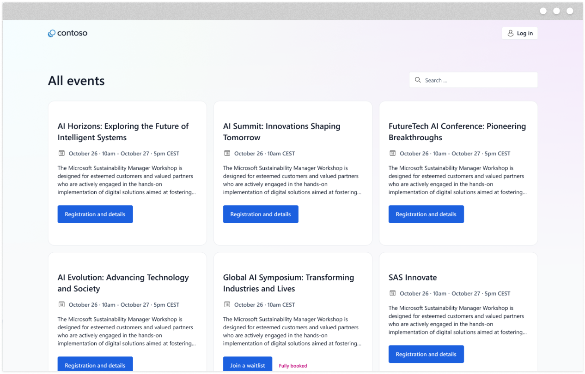
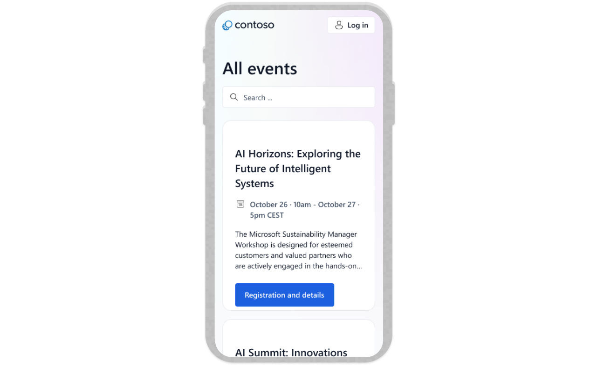
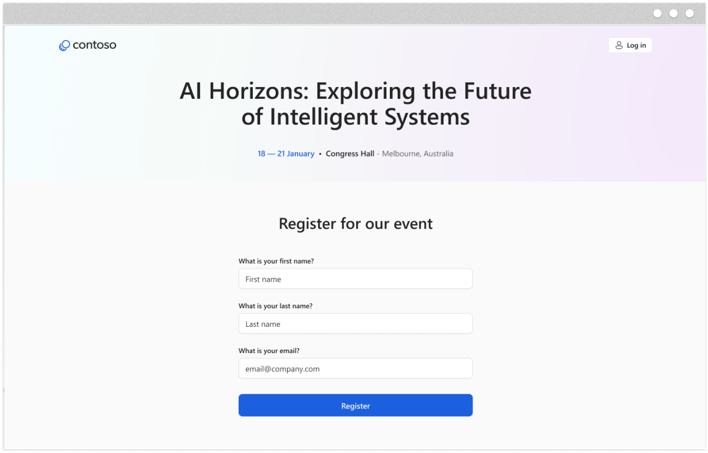
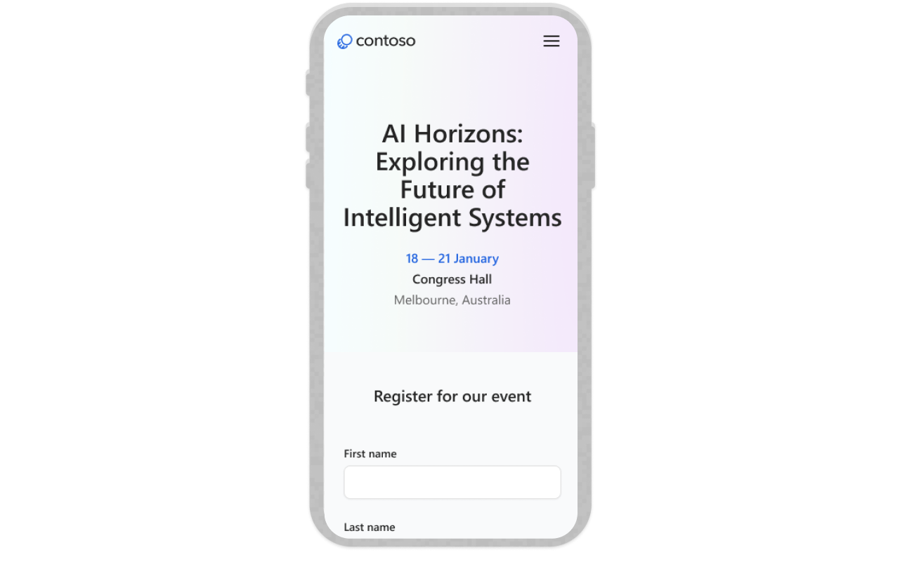
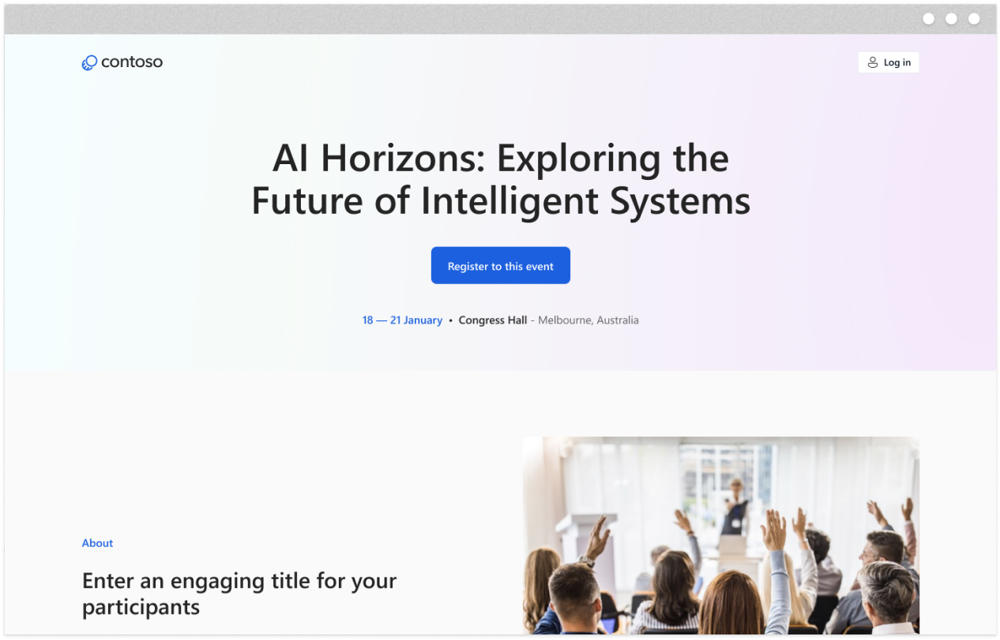
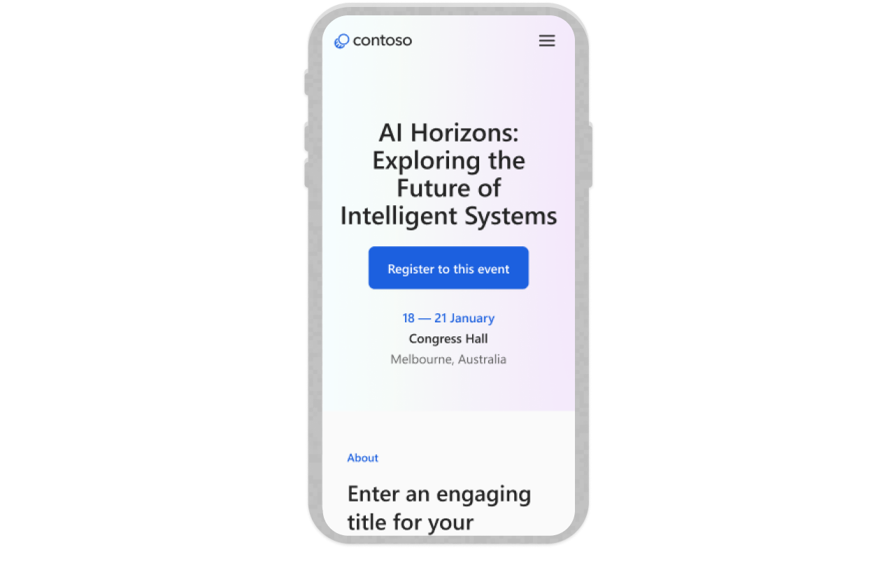

# Event Portal

Event Portal provides event discovery, event details, speaker and agenda information, and an event
registration experience.

The site is provisioned by the Power Pages Create Website API and requires the applicable Customer
Insights - Journeys capabilities. Some components can require pro-developer customization. This
directory contains reference screenshots only; use
[`templates/manifest.json`](../../manifest.json) for the exact API identifier, requirements,
warning, and catalog metadata.

## Previews

| Home page | Home page on mobile |
| --- | --- |
|  |  |

| Registration page | Registration page on mobile |
| --- | --- |
|  |  |

| Event information | Event information on mobile |
| --- | --- |
|  |  |
