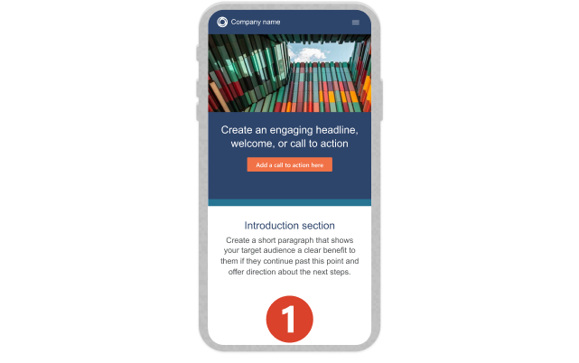
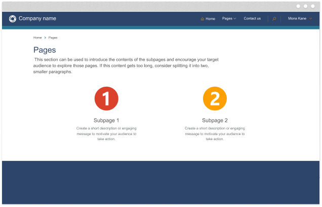
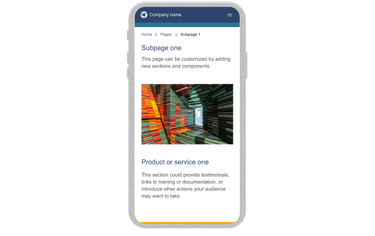
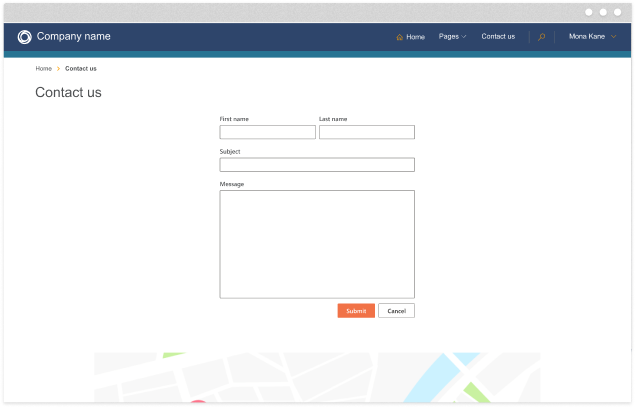
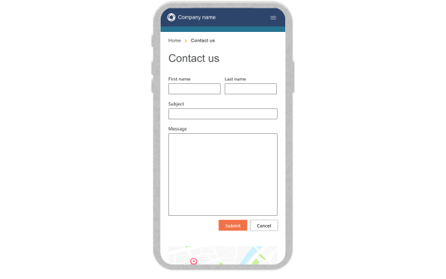

# Starter Layout 1

Starter Layout 1 is a multipage Power Pages starting point with navigation and common page
building blocks that can be customized for a new site.

The site is provisioned by the Power Pages Create Website API. This directory contains reference
screenshots only; it does not duplicate the platform-owned website source or solutions. Use
[`templates/manifest.json`](../../manifest.json) for the exact API identifier and catalog metadata.

## Previews

| Home page | Home page on mobile |
| --- | --- |
|  |  |

| Sub page 1 | Sub page 1 on mobile |
| --- | --- |
|  |  |

| Sub page 2 | Sub page 2 on mobile |
| --- | --- |
|  |  |
