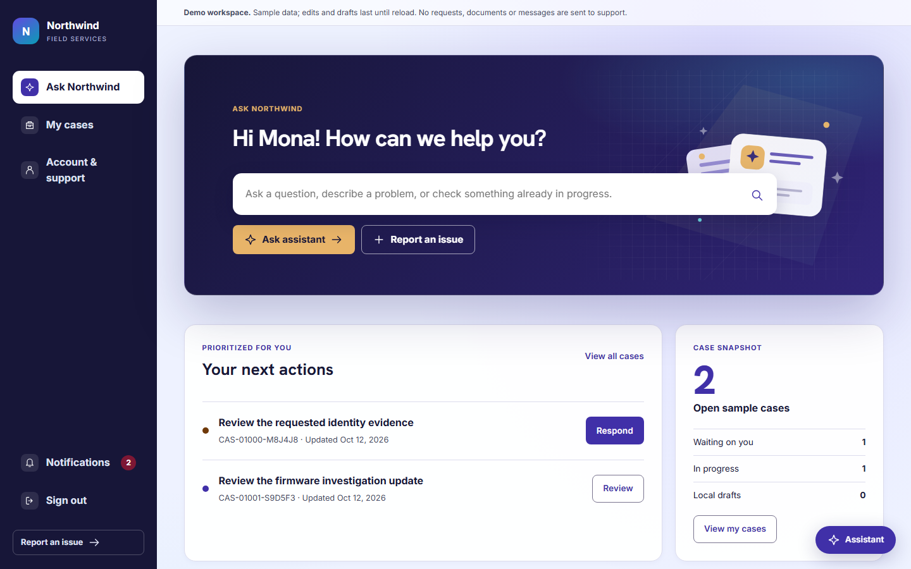
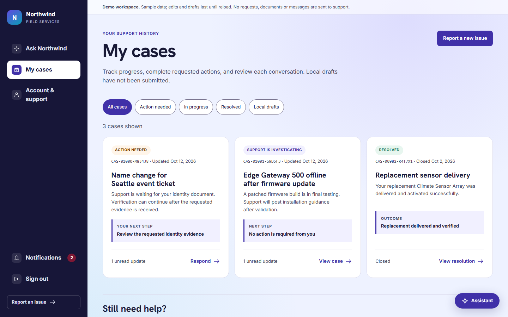
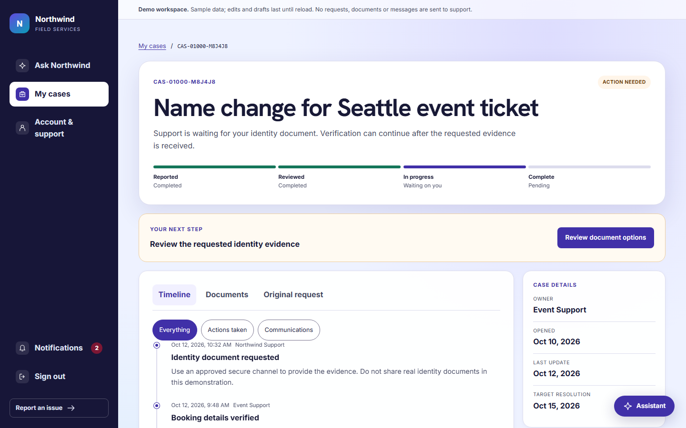
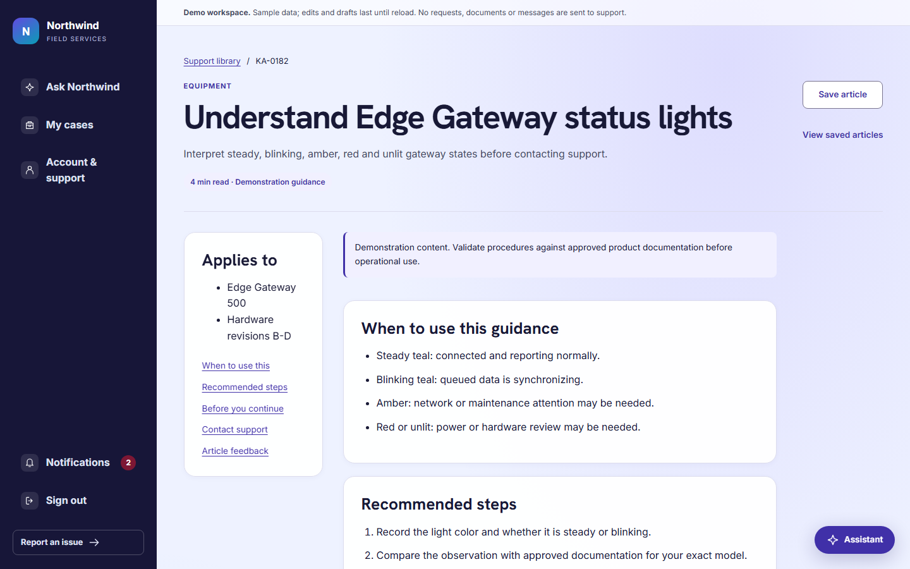
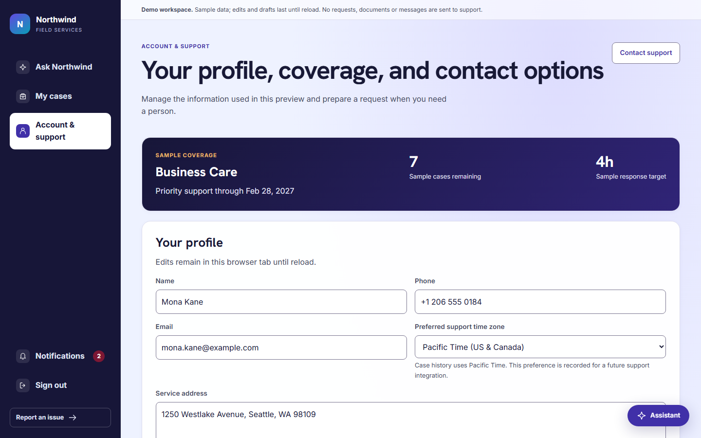

# Modern CSS Template

The Modern CSS Template is an installable Power Pages SPA for customer support. Signed-in customers create and track their personal cases, reply to support and share documents. Everyone can browse published knowledge articles, with optional generative AI search grounded only in knowledge. New portal cases can be handed to the Dynamics 365 **Case Management Agent**, and representative-approved responses are published back to the case conversation. The template contains a shared unmanaged Dataverse solution and a React SPA site under `variants/react/website-code/`, branded with the fictional **Northwind Field Services** identity.

## Previews

| Home | My cases |
| --- | --- |
|  |  |

| Case details | Knowledge article |
| --- | --- |
|  |  |

| Account and support |
| --- |
|  |

## Data model

The site uses standard Dynamics 365 Customer Service and Power Pages tables, with no custom tables:
- `incident` stores the customer's cases (Web origin, Contact as customer).
- `adx_portalcomment` stores the customer-visible case conversation.
- `annotation` stores customer documents and internal automation records.
- `knowledgearticle` provides published external knowledge.
- `contact` is the signed-in portal identity.

There is no seed data. The site works with your environment's cases and published knowledge articles. Run the website code locally with `npm run dev` to see the built-in demonstration content.

The **ModernCSSMetadata** solution adds only the supporting components the site depends on:

| Component | Purpose |
| --- | --- |
| Cloud flow **Northwind - Case Management Agent (review required)** | Dispatches portal-created Web cases to the Case Management Agent in review-required (Semi) mode. |
| Cloud flow **Northwind - Publish reviewed response to portal** | Publishes a representative-approved reply as a customer-visible Portal Comment. |
| Connection reference `cr719_northwindportalresponseconversion` (Content Conversion) | HTML-to-text conversion in the publish flow. |
| Plug-in assembly `Northwind.SendApproval` and its **Send**/`email` PreValidation step | Captures the reviewed reply snapshot when a representative uses native **Send**. |
| System view **Northwind KB Search** on `knowledgearticle` | Knowledge-only scope for AI search. |
| Environment variables `ppst_ModernCss_PortalApplicationUserId`, `ppst_ModernCss_PortalUrl`, `ppst_ModernCss_ApprovalWriterUserId` | The site's application user ID, the site URL and the environment's SYSTEM user ID. |

See the [website code README](variants/react/website-code/README.md) for the site architecture, permissions, server logic, AI search and agent integration details.

## Install manually

Use these steps when installing the template without an installer skill.

The catalog marks `ModernCSSMetadata` with `"publishChanges": true`.
Import it with `pac solution import --publish-changes` so the knowledge search view is published.
The PAC publication step can include other pending customizations in the target environment.

Unlike templates whose solutions only add tables, this solution needs the site's application user ID as an environment variable value. Upload the site first so that user exists, then import the solution.

### Prerequisites

- Install the [Power Platform CLI](https://learn.microsoft.com/power-platform/developer/cli/introduction).
- Install English (LCID 1033) in the target Dataverse environment.
- Install Dynamics 365 Customer Service with Case Management Agent (Case Management Intelligence) and knowledge management. The solution depends on `PowerPages_RuntimeCore`, `msdynce_Service`, `msdyn_CaseManagementIntelligence` and `msdyn_KBSuggestionsAiBCore`.
- In Power Pages Admin Center, open the environment's **Privacy + Security** settings and remove `*.js` from **Blocked Attachments**.
- Install Node.js 20 or newer and npm for the React project.
- For AI knowledge search, enable Dataverse search and Power Pages generative AI site search for the environment.

### Build and upload the SPA site

Run these commands from the repository root:

```bash
cd templates/spa/modern-css-template/variants/react/website-code
npm ci
npm run build
pac pages upload-code-site --rootPath .
```

Set `VITE_KB_AI_SEARCH_ENABLED=true` before `npm run build` to turn on AI search.
Uploading creates the site and its **Portals-&lt;site name&gt;** application user.
After upload, update environment-specific site settings such as `Northwind/KnowledgeLanguageLocaleId`, as described in the website code README.

### Import the supporting solution

1. Sign in to the target environment:

   ```bash
   pac auth create --url https://YOUR-ENVIRONMENT.crm.dynamics.com
   ```

2. From the repository root, pack the unmanaged solution and create a deployment settings file:

   ```bash
   temp_dir="$(mktemp -d)"
   trap 'rm -rf "$temp_dir"' EXIT
   pac solution pack --zipfile "$temp_dir/modern-css-metadata-unmanaged.zip" --folder templates/spa/modern-css-template/solutions/ModernCSSMetadata --packagetype Unmanaged
   pac solution create-settings --solution-zip "$temp_dir/modern-css-metadata-unmanaged.zip" --settings-file "$temp_dir/settings.json"
   ```

3. Edit `settings.json`:
   - `ppst_ModernCss_PortalApplicationUserId`: the `systemuserid` of the site's **Portals-&lt;site name&gt;** application user.
   - `ppst_ModernCss_PortalUrl`: the site URL, for example `https://contoso.powerappsportals.com`.
   - `ppst_ModernCss_ApprovalWriterUserId`: the `systemuserid` of the environment's **SYSTEM** user.
   - The connection IDs for the Content Conversion connection reference.

4. Import the solution:

   ```bash
   pac solution import --path "$temp_dir/modern-css-metadata-unmanaged.zip" --settings-file "$temp_dir/settings.json" --publish-changes
   ```

5. Confirm that both cloud flows are turned on, and that they use the Dataverse connection reference provided by Case Management Intelligence.

### Configure the Case Management Agent

The solution doesn't include environment content or settings. Configure them in the target environment:

1. Create a business line set to **Require agent confirmation**, with routing rules that select it for Web cases created by the site's application user.
2. Map AI-eligible intents to your published external knowledge articles. Unknown intents hand off to a representative.
3. Configure an approved outgoing mailbox for support replies.

Representatives review the agent's draft email and use the normal **Send** button. The publish flow then posts the approved reply to the customer's case conversation, even if the email itself is rejected.
See [Set up Case Management Agent to resolve cases](https://learn.microsoft.com/dynamics365/customer-service/administer/set-up-case-resolution-agent).
