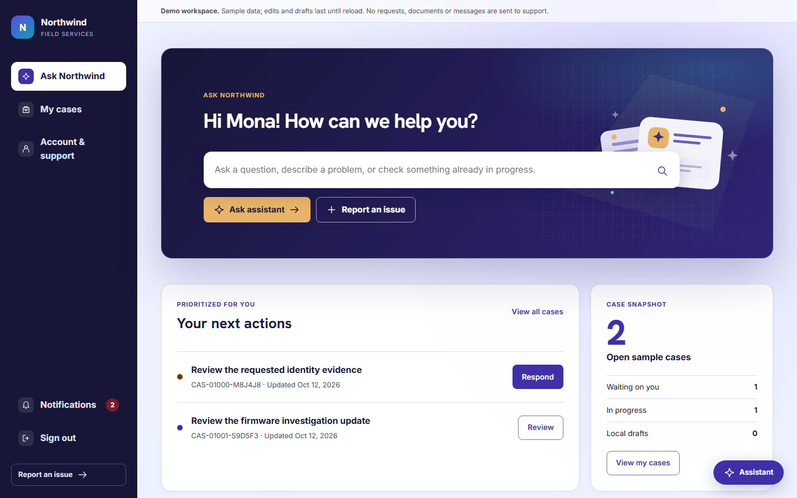

# Modern CSS Template — Northwind Customer Support

A React + Vite Power Pages code site (SPA) for customer support, branded with the fictional **Northwind Field Services** sample identity. Signed-in customers track their personal cases, reply to support and share files; everyone can browse published knowledge, with an optional AI-generated answer grounded only in knowledge articles. Case and reply updates arrive as in-app notifications, and new portal cases can be handed to the Dynamics 365 **Case Management Agent** in Full automation mode. Qualifying accepted outgoing emails are published back to the case conversation.



| Folder | Contents |
| --- | --- |
| `variants/react/website-code/` (this folder) | Site source, Power Pages metadata (`.powerpages-site`), tests and the case-management flow definitions. |
| [`../../../solutions/ModernCSSMetadata/`](../../../solutions/ModernCSSMetadata/) | The unpacked, unmanaged **ModernCSSMetadata** solution with the Dataverse customizations the site depends on. See [Template solution](#template-solution-moderncssmetadata). |

Installation steps for the whole template family are in the [template README](../../../README.md).

## Prerequisites

- Node.js 20 or newer and npm.
- [Power Platform CLI](https://aka.ms/PowerPlatformCLI) (`pac`) to upload the code site and import the solution.
- A Dataverse environment with Power Pages and **Dynamics 365 Customer Service** (cases, knowledge articles, Portal Comments).
- For the agent integration: the **Case Management Agent** (Case Management Intelligence) and an approved outgoing mailbox.
- For AI knowledge search: Dataverse search and Power Pages generative AI site search allowed for the environment.

## Run locally

```powershell
npm ci
npm run dev -- --host 127.0.0.1
```

Open the URL printed by Vite. To create and preview the production bundle:

```powershell
npm run build
npm run preview -- --host 127.0.0.1
```

The build writes static files to `dist`. Inter, Hanken Grotesk, and the Arabic fallback load from Google Fonts, so an internet connection is needed for those fonts.

### Data modes

| Mode | Selection | Behavior |
| --- | --- | --- |
| Demo | Default `npm run dev` | Sample records and tab-local edits; no uploads or backend writes. |
| Dataverse | Default production build | Requires the deployed endpoints, table permissions and an authenticated Power Pages session on the same origin. |
| Local integration testing | Open a dev URL with `?data=dataverse` | Uses real client code; browser tests mock the portal endpoints. Loopback alone cannot provide a portal login. |
| Explicit override | `VITE_SUPPORT_MODE=demo` or `dataverse` | Build/start-time override; other values are rejected. |

For an offline demonstration bundle in PowerShell:

```powershell
$env:VITE_SUPPORT_MODE = "demo"
npm run build
Remove-Item Env:\VITE_SUPPORT_MODE
```

Rebuild without that override before deploying the connected version. A failed connected request shows an error or sign-in state, never sample records. No Dataverse bearer token, PAC credential or account password belongs in frontend configuration.

## Experience and routes

| Route | Experience |
| --- | --- |
| `/` | Signed in: greeting hero with unified case/article search (grouped Cases and Support articles menu), Ask assistant and Report an issue actions, next actions, case snapshot, knowledge categories, bookmarks, and support shortcuts. Signed out (anonymous portal session): welcome hero with an articles-only search (Enter or **View matching support articles** filters the library; a `KA-…` number opens that article), **Still need help? Sign in to continue**, the support library and shortcuts. Signed-out visitors load only published knowledge through `northwind-knowledge`; no case, profile, catalog or AI Search Summary data is requested. If anonymous knowledge is unavailable (for example while the site is private), the hero shows only the sign-in card. |
| `/?id=<articleGUID>` | Knowledge citation entry point: waits for the complete authorized catalogue, then replaces this history entry with `/articles/:id`. |
| `/cases` | Personal cases, filters and case submission; demo mode uses fixtures and local drafts. |
| `/cases/:id` | Customer-visible conversation, request details, file upload/download and keyboard-operable tabs. Connected URLs use Dataverse GUIDs. |
| `/articles/:id` | Published external knowledge as inert plain text, tab-local bookmarks and persisted helpfulness feedback. |
| `/account` | Own name/phone updates, read-only email/account information and a persisted support-contact request. Unsupported coverage/equipment/orders are explicitly not connected. |
| Unrecognized routes or record IDs | Accessible not-found states with working navigation. |

The sidebar holds navigation, **Sign out** (`/Account/Login/LogOff`) or **Sign in** (`/SignIn?returnUrl=…`), and an outline **Report an issue**. A sticky header shows the signed-in customer's name and email beside **Notifications**; the identity links to Account & support and reflows on narrow screens. My cases, Account & support, notifications and the assistant appear only to signed-in customers. The initial profile check treats HTTP 401, and also HTTP 403 (returned on a private site to visitors who passed the Microsoft Entra gate without a portal sign-in), as signed out; a 403 later in a session remains an access error. In demo mode, Sign in/Sign out simulate the portal session locally through a profile picker; nothing is collected or sent.

The incident status reason (`statuscode`) drives the state shown on case cards, filters, the case header, progress steps and the next-step panel: Waiting for Details → **Action needed** (with **Respond**, which focuses the reply form); Researching → **Support is investigating**; On Hold; In Progress; Problem Solved/Information Provided → **Resolved**; Cancelled; and Merged. The timeline lists portal-comment replies from support and the customer, plus **Case submitted** (`createdon`) and closure (`modifiedon`) entries, newest first, with **Everything / Actions taken / Communications** filters.

When the customer sends a reply on a case that is **Waiting for Details**, `northwind-case-activity` saves it and then returns the case to **In Progress** (status reason 3 → 1, re-checked immediately before the update so a representative's intervening change is left alone). Native attachments use an IDs-only `attachmentReceipt` request to verify both saved records and confirm protected post-save processing before applying that transition. The case view re-reads the case to show confirmed status. Ambiguous writes and failed receipts show explicit warnings and never automatically resubmit the file.

The three sample case IDs are `CAS-01000-M8J4J8`, `CAS-01001-S9D5F3`, and `CAS-00982-R4T7X1`. Article IDs are `KA-0182`, `KA-0214`, `KA-0341`, `KA-0408`, `KA-0430`, and `KA-0362`. Those fixture IDs are available only in demo mode.

The **Northwind Assistant** is a floating widget (minimized to an **Assistant** button by default on narrow screens) that expands into a non-modal panel that stays open across navigation. Demo mode retains scripted case/article matching, the gateway guide and inline ticket drafts without bot requests. Connected mode uses a configured Copilot Studio bot through Direct Line. **Raise a ticket** retains the same case-creation flow as **Report an issue**; **Contact support** opens the support-contact form. Connected chat transcripts are not automatically copied into cases or contact requests. Connected uploads accept PDF, Word, PNG, JPEG, GIF and ZIP up to 3.75 MiB (3,932,160 bytes); demo file selection records metadata only.

### Support assistant bot

Connected deployments require two non-secret build settings: `VITE_BOT_ENVIRONMENT_ID` (the bot's Power Platform environment GUID) and `VITE_BOT_SCHEMA_NAME` (the bot's schema name). There is no default bot or environment. Missing or invalid settings show an explicit configuration error when the assistant opens, without loading the chat SDK or requesting a bot token. Demo mode does not require these settings.

```powershell
$env:VITE_BOT_ENVIRONMENT_ID = "<bot-environment-guid>"
$env:VITE_BOT_SCHEMA_NAME = "<bot-schema-name>"
npm run build
```

Rebuild after changing either setting. The environment host mapping supports commercial production environments only. Publish the agent, enable its web channel and configure its Power Pages authentication in the target environment before use; the template does not deploy a Copilot Studio agent.

The client resolves `/powervirtualagents/regionalchannelsettings?api-version=2022-03-01-preview` and `/powervirtualagents/botsbyschema/<schema>/directline/token?api-version=2022-03-01-preview` on the environment API host. Direct Line uses the returned regional domain and refreshes its token automatically. On connect, the client sends `startConversation`; outgoing activities carry `cci_webchat_client: msportals`. OAuth cards trigger a same-origin, CSRF-protected POST to `/_services/auth/portalusertoken`, followed by POST `{ token }` to the card's validated Microsoft token endpoint.

Web Chat 4.18.0 loads lazily from `/webchat-4.18.0.js` with SHA-384 integrity verification inside the same-origin `bot-chat.html` iframe, isolating its bundled React runtime from React 19. The verified official SDK and its upstream license notices are in `public` and are copied into `dist` during the build; no CDN access or additional allowed script source is needed at runtime. The build includes both HTML entry points. Site network rules must allow the environment API, the returned Direct Line HTTP/WebSocket host, the OAuth token endpoint and a same-origin frame. Existing allowed-script protections are unchanged.

Tokens remain in memory. Closing the conversation or changing the signed-in contact discards the chat session; minimizing preserves it. Only questions explicitly submitted through assistant actions are sent; loaded case/article contents are not automatically shared. Unpublished agents, blocked SDKs and authentication failures show explicit errors with a restart action, never scripted fallback responses. No Direct Line secret, PAC credential or bearer token belongs in frontend configuration. Verify a successful authenticated conversation after deployment; mocked browser tests cannot establish the target bot's availability.

Bookmarks and preferences remain tab-local. Saving a contact request creates feedback, not email, chat, a staff notification or a callback booking. Product/category catalogs do not prove equipment ownership, service coverage or order history.

## In-app case and support-reply notifications

When the Power Pages client API is available, the signed-in workspace uses `Microsoft.PowerPages.onPagesClientApiReady` and subscribes separately to the logical tables `incident` and `adx_portalcomment` with `$pages.data.subscribeToChanges` (falling back to `$pages.realtime.subscribe` on earlier client API builds). Cleanup calls each returned handle's `unsubscribe()`. Enable the site's realtime data-change feature (the `RealtimeNotifications/Enabled` site setting) for these events.

Events are treated only as invalidations: the app reloads the paginated, contact-filtered case list and validates ownership before displaying changes. For Portal Comment invalidations, it reads the authorized conversation of each listed case, with at most three concurrent reads. It never renders event payloads, fetches event-supplied record IDs, queries the raw Portal Comment Web API, or manages realtime grants or tokens. A support reply is a customer-visible Portal Comment with direction `2`; reply detection does not rely on the parent case's modified time.

Initial case records and the first conversation snapshot for each case are silent baselines. Changed known cases produce one latest case notification per case; new or edited Support comments, including subject-only changes, produce a separate support-reply notification even when the case itself is unchanged. Customer comments never generate support-reply alerts. The bell offers mark-read, mark-all-read, dismiss and open-case actions; reply links open the case conversation. Duplicate or reconnect invalidations with unchanged records do not notify again. Cases that are no longer accessible are removed from the list and bell. Failed refreshes show an error and retry action; authentication or access failures clear private case data.

**Case status and lifecycle updates** and **Replies from support** in Account & support independently control new alerts. Notifications and preferences exist only in the current tab: there is no browser/OS push, email or cross-session delivery. When the client readiness API or subscription method is absent, polling checks authorized cases and replies every 60 seconds while visible and online, backing off to at most five minutes after failures. Subscription/readiness errors still show an explicit retry action. Open conversations refresh without losing the active tab or unsaved reply/edit drafts.

## AI knowledge search (preview)

**Default-off build gate:** `VITE_KB_AI_SEARCH_ENABLED` must equal the exact string `true` at build or dev-server startup for the connected search surface to request a summary. Unset, empty, `false` and all other values keep it off. A default build sends **no Search Summary request**, shows a setup-unavailable notice on search submission, and keeps ordinary case/article keyword matches. Demo mode never calls AI. The gate is rollout protection, not a substitute for server-side knowledge scoping.

When enabled, submitting the main support search requests an AI answer above the keyword matches. Typing alone never calls AI, and the request contains only the entered query. `src/services/aiSummaryService.ts` posts a form-encoded `userQuery` to `/_api/search/v1.0/summary` with the CSRF token, distinguishes disabled/auth/network/service/malformed/empty outcomes, and verifies every citation against the complete authorized article catalogue. Only same-origin knowledge routes are accepted: Home `/?id=<guid>`, `/page-not-found/?id=<guid>`, `/articles/<guid>`, or classic `/knowledgebase/article/KA-...`. Unknown, foreign, case, duplicate or contradictory sources suppress the entire answer. AI output is rendered as text plus validated citation links, never HTML. Query edits, cancellation and unmount invalidate earlier requests. An HTTP 200 `{Code:400,Message:"Gen AI Search is disabled."}` shows governance remediation rather than an empty answer.

Site configuration (in `.powerpages-site/site-settings` and the template solution):

- `Search/EnableGenerativeAI = true`, `Search/Enabled = true`, and `search/query` cleared to an empty value, as [required for generative AI search](https://learn.microsoft.com/power-pages/configure/search/generative-ai).
- `Search/IndexQueryName` names the dedicated **Support KB Search** view on `knowledgearticle`, shipped in the [template solution](#template-solution-moderncssmetadata). The view limits search to published, external, non-root articles in the configured language within their publication/expiry window. Keep the setting and the view name identical.
- `Search/FacetedView = false`, matching the generative search limitation.
- The `knowledgearticle_SearchResultPage` site marker targets Home, so citations open in the SPA. Do not point the reserved **Knowledge Article** marker at the SPA Home page; that hands Home to native knowledge-page handling.

Enable Dataverse search for the environment and allow generative AI site search in governance: tenant AI governance overrides Copilot Hub environment/site access, which overrides the maker toggle at **Set up workspace → Copilot → Site search (preview)**. If you use the **Refine your data** wizard, compare the shared `Portal Search` views before and after; it can change shared views rather than create a site-specific source. Only one version of an article is published at a time ([Manage knowledge article versions](https://learn.microsoft.com/dynamics365/customer-service/use/ka-versions)), so the view relies on the published state rather than a newest-version filter.

Citation validation in the browser is defense in depth, **not** a retrieval or authorization boundary. Do not enable case grounding, broaden table permissions or enable the raw knowledge Web API for this feature.

> **Note**
>
> AI summarization APIs are a preview feature. Preview features aren't meant for production use and may have restricted functionality.

## Dataverse contract and access

The site uses nine existing Dynamics 365 tables. It creates no new customer-data tables, authentication providers or external secrets.

| Table | Authenticated Users access | Purpose |
| --- | --- | --- |
| `contact` | Self: Read, Write, Append, Append To | Own first/last name and phone, and linking the signed-in Contact to a case; identity, email, account membership and security fields are not accepted as edits. |
| `account` | Contact via `contact_customer_accounts`: Read | Only the account associated with the signed-in contact. |
| `incident` | Contact via `incident_customer_contacts`: Read, Create, Write, Append, Append To | Contact-as-customer cases only; no account-wide or extra primary-contact access. |
| `adx_portalcomment` | Parent personal case via `incident_adx_portalcomments`: Read, Create, Write, Append, Append To | Portal conversation and parent of native attachments; Web API column permissions prohibit trusted-subject/direction writes. |
| `annotation` | Parent case comment via `adx_portalcomment_Annotations`: Read, Create, Write, Append | Native customer attachments. Web API column permissions allow Create/Read on six explicit fields, never Update; the old direct `Incident_Annotation` grant has no rights. |
| `knowledgearticle` | Global: Read, Append To | Server-filtered external published content; raw Web API disabled. |
| `product` | Global: Read, Append, Append To | Read-only choices with relationship linking for an optional case product. |
| `category` | Global: Read | Read-only catalog. |
| `feedback` | Global: Create, Append | Server-bound author and eligible article reference; no customer reads or edits. |

There are no Delete grants or anonymous customer-data grants. The only anonymous grant is **Northwind - Anonymous published knowledge**: Global Read on `knowledgearticle` for the Anonymous Users role, used by `northwind-knowledge` and site search, both of which return only published, external, non-root articles in the configured language. Anonymous Users is also assigned to the `northwind-knowledge` Server Logic; every other handler stays authenticated-only. On a private site, visitors who passed the Entra gate without a portal sign-in don't get the Anonymous Users role, so anonymous article search works only on a public site. Both Web API and Server Logic respect table permissions. Raw Web API remains disabled for contact, account, knowledge, feedback, identity and internal-activity tables. Personal cases, product/category catalogs and native portal-comment/annotation attachment APIs are enabled with exact field allowlists and column-permission profiles.

The case field allowlist is `_customerid_value,caseorigincode,createdon,customerid_contact,description,incidentid,modifiedon,productid,statecode,statuscode,ticketnumber,title`. The **Case API** column-permission profile is assigned only to Authenticated Users: default Read, with Create + Read overrides for `title`, `description`, `caseorigincode`, `customerid_contact` and `productid`, and no Update. These settings block direct status/number/ID writes and customer reassignment through the Web API, while guarded Server Logic handles case edits. Keep enhanced authorization disabled (`0`): classic column permissions apply to Web API, not Server Logic. Self Contact and Product permissions need **Append** as well as Append To for native case creation, and the customer column override must name the polymorphic navigation property **`customerid_contact`**, not `customerid`.

| Endpoint (relative to your site URL) | Methods | Contract |
| --- | --- | --- |
| `/_api/serverlogics/northwind-profile` | GET, PATCH | Own profile and related account; allowlisted name/phone edits. |
| `/_api/incidents` | GET, POST | Paginated personal cases and native case creation with the authenticated profile's Contact binding. |
| `/_api/incidents(<guid>)` | GET | Fetch the saved case and ticket number after a successful create. |
| `/_api/serverlogics/northwind-cases` | PATCH | Active, owned-case title/description edits. |
| `/_api/serverlogics/northwind-knowledge` | GET | Published external knowledge, including publication/expiry and eligible-version checks. Available to anonymous and signed-in visitors. |
| `/_api/serverlogics/northwind-case-activity` | GET, POST | Case-authorized conversation/document references, guarded customer replies and IDs-only attachment receipts. |
| `/_api/adx_portalcomments` | POST | One native deep insert creates a customer comment and its Note attachment with client-assigned IDs. |
| `/_api/annotations(<guid>)` | GET | Direct single-record attachment metadata/content reads, checked against authorized case references. |
| `/_api/serverlogics/northwind-feedback` | POST | Article helpfulness or a contact request with server-owned authorship. |

Server Logic returns a normalized `{status:"success",data:...}` or `{status:"error",code,message}` inside Power Pages' execution envelope; native Web API reads return Dataverse fields and `@odata.nextLink`. The shared client handles both contracts, uses cookie authentication and supplies `__RequestVerificationToken` from `/_layout/tokenhtml` on all requests. It rejects malformed DTOs and invalid pagination rather than substituting data.

Case POST sends only the derived title, description including business impact, `caseorigincode: 3` (Web), `customerid_contact@odata.bind` from the authenticated profile, and optional `productid@odata.bind`. Dataverse supplies status, ownership, IDs and ticket numbers. The client accepts an empty 204, reads the GUID from the `entityid` or `OData-EntityId` header, then fetches and validates that exact case before showing success. Uncertain outcomes preserve the draft and ask the customer to reload cases rather than retrying automatically.

Knowledge language is set by the `Northwind/KnowledgeLanguageLocaleId` site setting. **Replace its value** with the ID of your environment's `languagelocale` record for the knowledge language (en-US/1033 in the template); the shipped value belongs to the source environment.

Attachments must have a note description (`annotation.notetext`) beginning with `*WEB*`, and a customer comment must reference the Note ID. The IDs-only receipt validates both rows and their case relationship before writing a protected comment subject: `Customer document uploaded` for signature-checked PDF/PNG/JPEG, or `Customer attachment uploaded` for other allowed attachments. These markers confirm file intake, not identity. Case conversations include marked and unmarked Incoming/Outgoing comments, display their subjects as text and omit comments with null bodies. Legacy Notes directly attached to cases are no longer listed by this attachment contract; plan any required migration before updating an existing deployment.

The schema limits case descriptions and feedback messages to 2,000 characters. New-case description plus impact is capped at 1,898 characters, reserving room for the dispatch flow's portal case link; the flow independently checks the final 2,000-character limit. Case titles allow 200 characters, profile fields 50 each and customer replies 4,000. New attachments allow 3.75 MiB raw / 5 MiB base64; downloads retain the historical 5 MiB raw cap. The site is English (`en-US`, LTR); logical CSS, isolated inserted text, adaptive free-form controls and locale-aware formatting support future localization.

### Server Logic authoring notes

- The hosted validator rejects anonymous `function (...)` callbacks anywhere in a Server Logic file (`RTSL01: prohibited pattern`). Use arrow callbacks; `tests/server-logic.test.cjs` checks this pattern and the `with` restriction across all five handlers.
- The Dataverse connector returns a **JSON string**, not an object. Every handler decodes string responses before reading status, headers or body.
- A newly uploaded script can take a short time to replace the cached version; refresh rather than changing permissions.

## Source structure

| Location | Responsibility |
| --- | --- |
| `src/pages` | The five routed page types. |
| `src/components` | Layout/sidebar shell, native dialogs, fields, search, icons, the Northwind Assistant widget/panel, sign-in/sign-out controls (with the demo-only profile picker), and issue drafting. |
| `src/SupportContext.tsx` | Data mode, authenticated loading, DTO mapping, mutations, notifications and tab-local preferences/bookmarks. |
| `src/useCaseRealtime.ts` | Client API change subscriptions for cases and portal comments. |
| `src/services/supportApi.ts` | Shared CSRF-aware typed service, pagination, DTO validation and file transport. |
| `src/services/aiSummaryService.ts`, `src/hooks/useSearchSummary.ts` | Search Summary transport, guarded decoding, knowledge-only citation validation, and cancellable explicit-submit state. |
| `src/data.ts` | Sample records, search, and `Intl` formatting helpers. |
| `src/styles/theme.css` | Shared tokens, responsive layouts, interaction states, logical positioning, and reduced-motion behavior. |
| `tests/*.spec.ts` | Playwright desktop/narrow scenarios: demo behavior, mocked connected workflows, AI search and realtime notifications. |
| `tests/server-logic.test.cjs`, `tests/permissions.test.cjs`, `tests/case-management-flow.test.cjs` | Server Logic contract tests, metadata guardrails and flow-definition checks; not hosted verification. |
| `integrations/case-management/flow.json`, `publish-response-flow.json` | Case Management Agent dispatch flow and the accepted-Send publishing flow (also shipped in the template solution). |
| `.powerpages-site/` | Server Logic, table permissions, column permissions, web roles, site settings and other site metadata for `pac pages upload-code-site`. |
| `docs/customer-request-flow.md` | Customer request flow and key entities, including the email and portal paths after an accepted Send. |

## Tests

```powershell
npm test
npm run test:server
```

The Playwright configuration uses installed Microsoft Edge and starts or reuses the loopback Vite server. Set `$env:PLAYWRIGHT_CHANNEL = "chrome"` to use Chrome, and `$env:PLAYWRIGHT_PORT` to an unused port to avoid reusing another project's server. AI search tests that need the build gate run only when `VITE_KB_AI_SEARCH_ENABLED=true`:

```powershell
$env:PLAYWRIGHT_PORT = "5187"
$env:VITE_KB_AI_SEARCH_ENABLED = "true"
npx playwright test ai-search.spec.ts connected-support.spec.ts
Remove-Item Env:\VITE_KB_AI_SEARCH_ENABLED, Env:\PLAYWRIGHT_PORT
```

Demo tests reject unexpected writes. Connected tests mock same-origin portal responses and exercise success, failure and CSRF-protected writes. Server tests run the handlers against a mocked SDK. These checks cannot certify Power Pages runtime authorization.

## Case Management Agent integration

The **Case Management Agent (full automation)** cloud flow runs when Dataverse adds an active `incident` with `caseorigincode = 3` (Web) created by the site's application user (`ppst_ModernCss_PortalApplicationUserId`). Web origin alone is not the boundary: cases created by other applications are excluded. Portal case creation uses `/_api/incidents` and doesn't wait for agent processing.

The flow re-reads the case, checks its scope and calls `msdyn_GetCaseManagementAgentSettings`. Dispatch is blocked unless the effective resolution configuration is enabled and **Full** (autonomous). It appends the portal case link when the final description fits, creates an internal note whose ID equals the case ID, calls `msdyn_invokeCaseProcessingAgent`, and records whether dispatch was accepted. The deterministic note stops duplicate dispatch. Agent invocation has no automatic retries; a successful 204 means the request was accepted, not that the case was resolved.

Configure the agent per environment: a business line set to **Full**, approved AI-eligible intents mapped to published external knowledge, and routing rules selecting only this site's Web cases. **This changes the previous template's Semi/review-required gate: Full automation can send email and resolve cases without human confirmation.** Review governance and hand-off guidance before enabling it. Keep the effective-mode gate because a request parameter alone does not determine the matched business line's mode.

Qualifying outgoing replies appear on the portal once Dynamics accepts their Send, whether initiated autonomously or by a representative. Internal drafts are never exposed. The packaged initial dispatch does not retrigger on portal comments; the separate, uninstalled card-name continuation reference demonstrates that scenario. See [Case Management Agent setup](https://learn.microsoft.com/dynamics365/customer-service/administer/set-up-case-resolution-agent) and the [custom trigger API](https://learn.microsoft.com/dynamics365/customer-service/develop/use-case-processing-agent).

### Template solution (ModernCSSMetadata)

The site itself is rebuilt from this folder (with the Power Pages skills or `pac pages upload-code-site`), and target environments already have the Dynamics 365 Customer Service solutions. The unmanaged **ModernCSSMetadata** solution in [`../../../solutions/ModernCSSMetadata/`](../../../solutions/ModernCSSMetadata/) (publisher **Power Pages SPA Templates**, prefix `ppst`) carries only the Dataverse customizations the site depends on that neither provides:

| Component | Purpose |
| --- | --- |
| Cloud flow **Case Management Agent (full automation)** | Dispatches portal-created Web cases only when effective resolution is enabled in Full mode. |
| Cloud flow **Publish reviewed response to portal** | Publishes a qualifying accepted outgoing email; its retained display label does not guarantee human review. |
| Cloud flow **Document Verifier - Verify document**, **Document Verifier** Copilot Studio agent, **Document Verification** AI prompt | Optional document-verification building blocks; not a complete configured card-name workflow. |
| Content Conversion and Copilot Studio connection references | Bind to target connections; the publisher uses `ppst_sharedconversionservice_862f1`. The export also retains a legacy conversion reference. |
| System view **Support KB Search** on `knowledgearticle` | Knowledge-only AI search scope; `Search/IndexQueryName` must match. |
| Environment variables `ppst_ModernCss_PortalApplicationUserId`, `ppst_ModernCss_PortalUrl` | The site's application-user ID and the site URL. |

The refreshed unmanaged export is **1.0.0.2**, exported without changing the live version. Source portal URL and application-user defaults have been removed. The three flows are packaged in Draft state; bind connections and review activation in the target. It contains no plug-in, so nothing needs compiling or registering. Dataverse operations use the managed `IA.cr.IAPluginDVConnector` reference from **msdyn_IntentAssist**. The export declares dependencies on **PowerPages_RuntimeCore**, **msdynce_Service**, **msdyn_IntentAssist**, **msdyn_AISolution** and **msdyn_FieldServiceExperienceComponents** (the source environment's Knowledge Article layer); resolve these before import. Neutral component display names preserve the original IDs/schema identifiers, including older branded logical names, so this remains the same solution lineage.

Not included in this export: the site metadata (shipped separately under `.powerpages-site`), card-name continuation flow, intent/LOB records, their mappings and routing/configuration records, knowledge article content, search/governance configuration and attachment allowances. This is the current solution as exported, not a claim that all those items are inherently non-solution-aware.

### Intent and CMA configuration portability

The source environment registers the following **solution-aware** component types. These definitions/configuration records can be added to an unmanaged solution with their dependencies, then exported; they were investigated only and were **not added live** during this update.

| Configuration | Registered component types |
| --- | --- |
| Intents and lines of business (intent families) | `msdyn_intent` 11200, `msdyn_intentfamily` 11209 |
| Intent attributes, sets and configuration | `msdyn_intentattribute` 11201, `msdyn_intentattributeset` 11202, `msdyn_intentconfig` 11204 |
| Intent/knowledge and family mappings | `msdyn_intentsolutionmap` 11225, `msdyn_intentsolution_mappingconfiguration` 11226, `msdyn_intentfamilysolutionmap` 11210 |
| Intent playbooks | `msdyn_intentplaybook` 11223, `msdyn_intentplaybookmap` 11224 |
| Agent settings and decision/routing definitions | `msdyn_agentsetting` 11196, `msdyn_decisioncontract` 10798, `msdyn_decisionruleset` 10799 |

The source **Card Name change** intent exists only in the Default solution, while **Default LOB** is managed by `msdyn_IntentEngineCoreConfiguration`; neither is in ModernCSSMetadata. Managed configuration needs its owning solution/dependencies or supported customizations, not an assumed editable clone. No `msdyn_agentsetting` or `msdyn_decisionruleset` records were returned in the source inventory.

`integrations/case-management/card-name-intake-flow.json` is a **reference only**, not an installed solution workflow. Its intent and family GUIDs still identify the source configuration; replace them consistently, bind its connection references and validate its guards before adding it to a destination solution. The verifier bot schema is a stable solution identifier, not a display label. Do not enable this reference as-is or interpret a file-intake receipt as successful identity verification.

Connections, application users, mailbox approval, secrets, licensing/billing and environment governance still need destination-side setup. Exporting definitions alone does not make the entire CMA service configuration portable.

### Set up a new environment

1. Build and upload the site from this folder (see [Deploy to Power Pages](#deploy-to-power-pages)). Uploading creates the site and its **Portals-&lt;site name&gt;** application user.
2. Update environment-specific site settings, such as `Northwind/KnowledgeLanguageLocaleId`, and publish your external knowledge articles.
3. Pack the unpacked solution in [`../../../solutions/ModernCSSMetadata/`](../../../solutions/ModernCSSMetadata/) and import it with publishing, as described in the [template README](../../../README.md#import-the-supporting-solution) (`pac solution pack --packagetype Unmanaged`, then `pac solution import --publish-changes`), or import the packed zip in Power Apps. Enter the site's application-user ID and site URL, and bind Content Conversion, Copilot Studio and Dataverse connections. Review and activate only the flows/agent you intend to use.
4. Configure the Case Management Agent business line, intents and routing rules in **Full** mode after approving autonomous behavior; see the portability exclusions above.
5. Enable Dataverse search and generative AI site search if you build with `VITE_KB_AI_SEARCH_ENABLED=true`.
6. Configure an approved outgoing mailbox for support replies.

### Publish an approved response

The **Publish reviewed response to portal** flow publishes a qualifying reply when Dynamics accepts its normal **Send**, whether autonomous or representative-initiated. It doesn't wait for delivery and adds no approval step. For representative-authored replies:

1. Open the outgoing case email in Dynamics 365. Review and edit the complete body, including quoted history, signatures and any agent-generated guidance.
2. Confirm **Regarding** is the customer's portal case and the only **To** recipient is that case's Contact. Select an approved outgoing **From** mailbox and honor the Contact's communication preferences.
3. Use the normal **Send** button. Dynamics validates the email and, if it accepts it, sets its status to **Pending Send**. The flow doesn't send any additional email.
4. The flow posts the sent text to the portal. Publication doesn't depend on delivery: the response still publishes if the email later fails or stays in Pending Send. The customer refreshes their case page to see it as **Support** in the case conversation.

**If Dynamics rejects the Send, nothing is published.** For example, sending to a Contact marked **Do not email** fails before anything is saved, and the email stays a Draft. A cloud flow can only see changes that Dataverse commits, so it can't observe a rejected Send. Resolve the cause and Send again. For a Contact who has opted out of email, this flow can't publish a response; never clear their preference merely to publish to the portal.

The flow triggers when an outgoing `email` with a Regarding row is **Modified** to `statecode = 1` (Completed) and `statuscode = 6` (Pending Send). Only the native **Send** message (Web API action `SendEmail`) with `IssueSend: true` moves an email to Pending Send; server-side synchronization then sends it. Save, AutoSave and other edits leave it a Draft, and a record-only `IssueSend: false` marks it Sent directly, so none of them publish. Native Send is the release signal, not proof of human review; the dispatch flow now requires Full automation.

The flow then reads the email and its case. It quietly ends with a **Skipped** result unless the email concerns a Web case created by the site's application user, the case has a Contact customer, and that Contact is the only **To** recipient. Other emails continue through normal mail processing. The case audience is checked again just before publishing.

The published text comes from the email the flow reads, and the flow requires that email to still be **Completed** (Pending Send, Sending or Sent). Representatives can't edit a completed email, so the published text is what was sent. If the email has already reopened (for example as Failed) when the flow reads it, the run fails with `SendNotLocked` and publishes nothing; Send again to publish. Content Conversion produces plain text with a **1-4,000 converted-character** limit and no truncation. Email attachments and embedded images are not copied.

The new `adx_portalcomment` uses subject `Reviewed support response` (without a `*WEB*` prefix), outgoing direction `2`, and the email's case. A publication receipt, an internal note keyed by email ID, records the text, email version, sender and time, case and Contact, and comment ID so only one response is published per email. Legacy receipt markers remain recognized for duplicate protection; sending the same email again returns `AlreadyPublished`. Use a **new email** for a distinct follow-up. Portal publication and delivery have separate outcomes: inspect the reserved comment and prior run before recovery rather than resending email. Portal users have no email privileges.

See [Dataverse flow triggers](https://learn.microsoft.com/power-automate/dataverse/create-update-delete-trigger), [server-side synchronization](https://learn.microsoft.com/power-platform/admin/server-side-synchronization) and [Content Conversion limitations](https://learn.microsoft.com/connectors/conversionservice/).

## Replace demonstration content before launch

The three `SAMPLE CONTENT` markers in `src/data.ts` identify customer/coverage/equipment, cases/history/response expectations, and knowledge articles. Also replace the sample contacts, plan dates/terms, equipment serials, orders and service targets in `src/pages/Account.tsx`; notification examples in `src/SupportContext.tsx`; and the Northwind identity and copy throughout the UI. All article instructions and policies require product-owner approval.

Before accepting real customer data, approve the preview Server Logic dependency, confirm consent, retention, attachment scanning and delivery policies, and validate the integration on the target site. File signature checks are not malware scanning. The 3.75 MiB raw / 5 MiB encoded upload contract must also pass the portal's request-size, timeout and Dataverse attachment limits.

## Deploy to Power Pages

`powerpages.config.json` names the site, the `dist` build output and the `index.html` landing page. Build the connected version and upload it with PAC:

```powershell
npm run build
pac pages upload-code-site --rootPath .
```

Add `$env:VITE_KB_AI_SEARCH_ENABLED = "true"` before the build to turn on AI search. Always use `pac pages upload-code-site`, never `pac pages upload`. The environment must allow `.js` attachments.

After each upload, confirm every column-permission override under **Case API**, **Customer attachment comment API** and **Customer attachment annotation API** exists; if PAC omits one, add it through Portal Management or the Dataverse API rather than broadening default column permissions. On Windows, keep the project path short: deep paths can exceed metadata path limits during upload.
