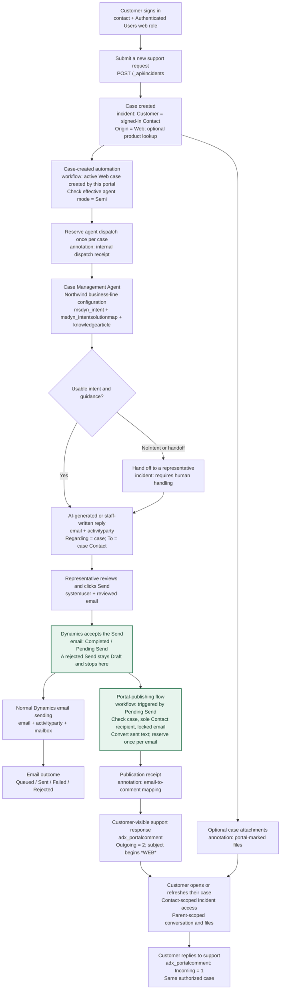

# Northwind customer request flow

When Dynamics accepts a representative's native **Send** (status **Pending Send**), a cloud flow publishes the sent text to the portal. No custom code is involved. Delivery has its own outcome: a queued or failed email doesn't block the portal response, but a Send that Dynamics rejects outright publishes nothing.

There is deliberately **no arrow from email outcome to portal publication**. Once Dynamics accepts the Send, the portal response publishes even if delivery later fails or stays queued. Publishing to the portal does not send or retry email. A Send that Dynamics rejects (for example, to a Contact marked **Do not email**) is never saved, so no flow can see it and nothing is published. Ordinary Save/AutoSave and record-only `IssueSend: false` never reach Pending Send, so they don't publish.

## Key entities by step

| Step | Key entity or configuration | Role |
|---|---|---|
| Customer identity | `contact`; web role | Identifies the signed-in customer and grants authenticated portal access. |
| Request creation | `incident`; optional `product`; portal application `systemuser` | Stores the request, Contact customer, Web origin, product association and creation provenance. |
| Customer files | `annotation` | Stores portal-designated attachments linked to the authorized case. This is separate from internal automation notes. |
| Automation | `workflow` | Defines the case-created automation and response-publishing cloud flow. |
| Agent dispatch | Internal `annotation` | Records dispatch and prevents repeated agent invocation for the same case. |
| Agent guidance | Business-line configuration; `msdyn_intent`; `msdyn_intentsolutionmap`; `knowledgearticle` | Selects supported guidance and enforces human-review mode. No matching intent can lead to human handoff rather than a draft. |
| Reviewed response | `email`; `activityparty`; staff `systemuser` | Holds the response and its sender/recipient relationships. The sole To recipient must be the case's Contact. |
| Accepted Send | `email` `statecode` / `statuscode` | Native `SendEmail` with `IssueSend: true` moves the email to Completed / Pending Send (6). That committed change is the release signal; representatives can't edit a completed email. |
| Publishing trigger | `workflow`; `callbackregistration` | Dataverse **Modified** trigger on `email`, filtered to outgoing, regarding, Pending Send. Runs asynchronously after the Send commits. |
| Email delivery | `email`; `activityparty`; `mailbox` | Handles normal email transport and its own status. It must not determine whether the approved portal response is published. |
| Publication tracking | Internal `annotation` receipt | Reserves one publication per source email and records its separate portal-comment ID, the sent text, the sender and the time. Existing published responses remain immutable. |
| Portal conversation | `adx_portalcomment` linked to `incident` | Stores outgoing Support responses and incoming customer replies. |

## Boundaries retained

- Customers see only cases whose Customer is their signed-in Contact, and the permitted comments/files under those cases. Internal dispatch and publication notes are not customer-visible.
- Raw Email and Portal Comment Web APIs remain disabled. Case activity is read through the existing ownership-checking Server Logic endpoint.
- Ordinary draft Save, AutoSave and record-only `IssueSend: false` do not authorize publication. An accepted native `IssueSend: true` Send is the release signal; it is not an independent audit that a human read the response.
- The publisher acts only for a Northwind portal case whose Contact is the email's sole To recipient, and rechecks the case's current Contact before writing. It uses the email's text only while the email is still Completed; if the email has reopened, the run fails rather than publishing edited text.
- The current publication contract is plain text, 1-4,000 converted characters, without silent truncation. Email attachments are not automatically copied into portal files.
- The email and portal comment use different activity IDs. Repeated Send actions must not duplicate an already published response.
- Editing a case or adding a customer reply does not automatically invoke the case-created agent flow again.
- A customer reply or document on a case that is Waiting for Details returns it to In Progress (status reason 3 → 1). No other status reason is changed by the portal.
- Neither agent handoff nor clicking Send implies the case is resolved. Case status remains separately managed.

See the [template solution](../README.md#template-solution-moderncssmetadata), the flow definitions in [`integrations/case-management`](../integrations/case-management/) and the [staff publishing instructions](../README.md#publish-an-approved-response).
