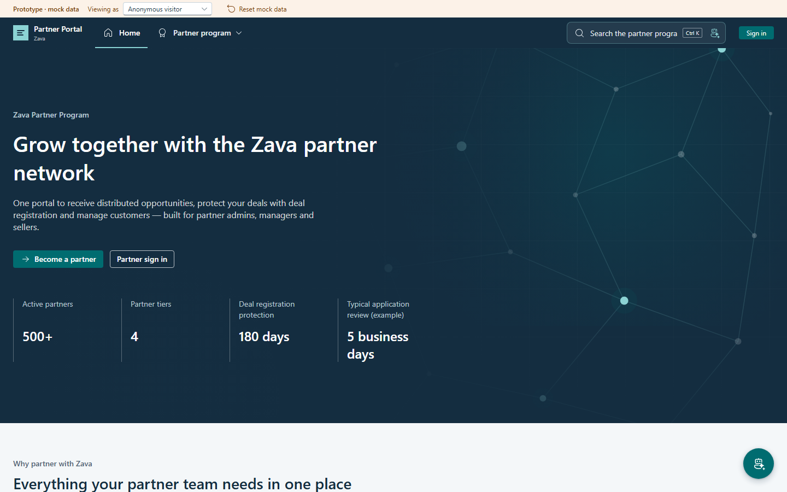
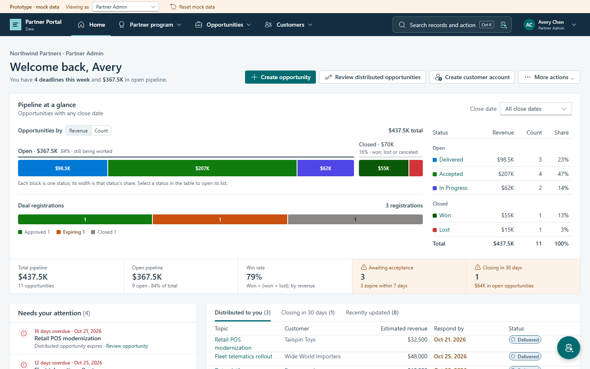
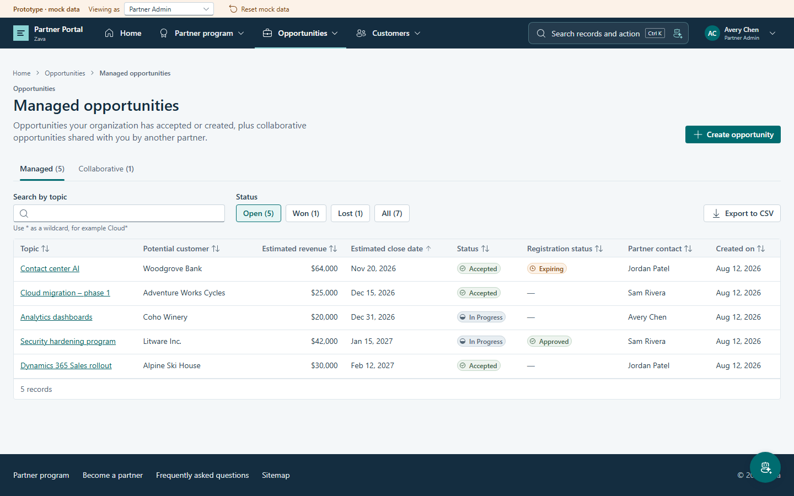
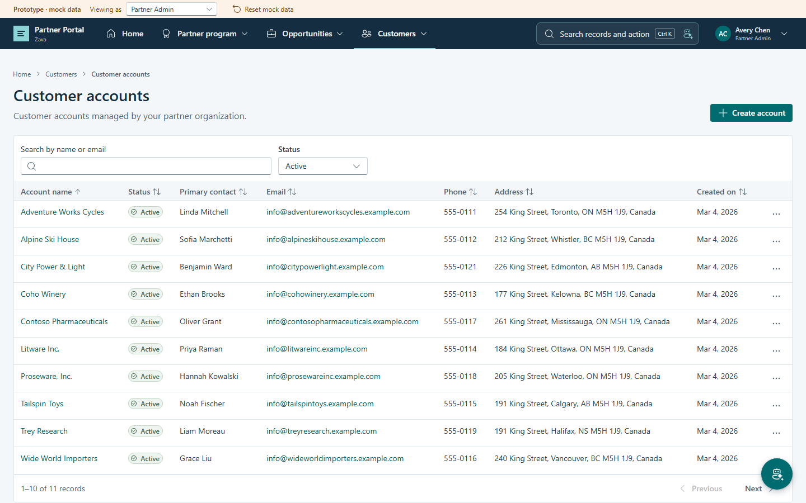
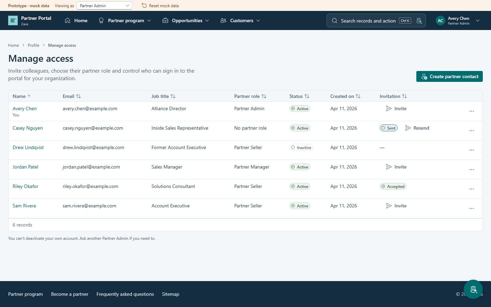

# Partner Portal (Enhanced) template

The Partner Portal (Enhanced) is a React + Vite Power Pages SPA for partner onboarding, customer and opportunity management, and access administration. The local development app uses browser-backed mock data; deploying the website code enables live behavior through Power Pages, Dataverse, and server logic.

## Previews

| Home | Partner dashboard |
| --- | --- |
|  |  |

| Opportunities | Customers |
| --- | --- |
|  |  |

| Access administration |
| --- |
|  |

## Included

- React website code in [`variants/react/website-code/`](variants/react/website-code/), including the Power Pages site configuration and server logic.
- The supporting unmanaged Dataverse solution `SPAPartnerPortalSite` in [`solutions/`](solutions/).
- English (LCID 1033) site content.

The source environment's URL, generated environment manifests, and connection credentials are not included. Configure target bindings before enabling live features. The app's local mock data is in `src/data/seed.ts`; it is not Dataverse seed data. Unlike templates with `seed-data/data.json`, this catalog entry does not provision demo Accounts, Contacts, or opportunities in Dataverse.

The supported partner roles are Partner Admin, Partner Manager, and Partner Seller. Public onboarding, authentication, and profile pages remain available to visitors and non-partner users. Existing local mock databases discard retired workspace collections and contact selections without resetting sales edits. Unknown live web roles receive non-partner UX.

## Install manually

### Prerequisites

- Install the [Power Platform CLI](https://learn.microsoft.com/power-platform/developer/cli/introduction) and Node.js/npm.
- English (LCID 1033) installed in the target Dataverse environment.
- Standard Power Pages solutions and the enhanced data model.
- The Partner Portal managed dependencies `MicrosoftPartnerPipeline` and `MicrosoftPartnerPipeline_V2`, plus the Dynamics 365 Sales/Product Management components used by opportunities and deal registrations. These are separate prerequisites, not supplied by installing standard Power Pages alone. Do not copy their tables into the supporting solution.
- Permission to import solutions and upload Power Pages code sites.
- In Power Pages Admin Center, allow `*.js` files by removing that extension from **Blocked Attachments**.

### Import the supporting solution

Sign in to the target environment:

```bash
pac auth create --url https://YOUR-ENVIRONMENT.crm.dynamics.com
```

The catalog marks `SPAPartnerPortalSite` with `"publishChanges": true`.
Import it with `--publish-changes`; that publication step can include other pending customizations in the target environment.
From the repository root, pack and import the unmanaged solution:

```bash
temp_dir="$(mktemp -d)"
trap 'rm -rf "$temp_dir"' EXIT
pac solution pack --zipfile "$temp_dir/partner-portal-unmanaged.zip" --folder templates/spa/partner-portal/solutions/SPAPartnerPortalSite --packagetype Unmanaged
pac solution import --path "$temp_dir/partner-portal-unmanaged.zip" --publish-changes
```

The supporting solution contains only the invitation and partner-role synchronization
flows, their Dataverse connection reference, and the required
`cr798_PartnerPortalDataverseUrl` environment-variable definition. It does not
re-export standard Power Pages, Partner Pipeline, or Sales table schemas.
Both flows ship **off** so they cannot process Contacts before the target site is configured.

On import, bind `new_sharedcommondataserviceforapps_b1053` to a target Dataverse
connection and set `cr798_PartnerPortalDataverseUrl` to the target organization root
(for example, `https://YOUR-ENVIRONMENT.crm.dynamics.com`, without a trailing slash).
This is not the public Power Pages site URL. Connection credentials and source
environment values are not shipped.

Before enabling invitations, verify that the installed managed prerequisites provide
the classic invitation process called by `ExecuteWorkflow`
(`c0225729-ade6-4131-80e4-974ad0c97ccd`). Its definition is not included in this
supporting solution; if that process is absent, resolve the prerequisite or configure
the flow against the target's equivalent process before enabling it.

### Configure portal users

Provision real target-environment Accounts and Contacts separately from solution import:

1. Configure the partner Account and associate each partner Contact with it.
2. Set the Contact's **Partner Contact Role** (`adx_partnercontactrole`) to Partner Admin, Partner Manager, or Partner Seller.
3. Assign the corresponding site web role after the website has been uploaded. If using the role synchronization flow, configure and enable it only after resolving the target site roles.
4. Configure managing-partner relationships for customer Accounts/Contacts and partner opportunity assignments through the installed Partner Pipeline processes.

Account affiliation, managed-customer relationships, and web-role assignment are distinct.
The UI is not an authorization boundary: review table permissions and Server Logic and test cross-partner isolation before granting access. Local mock personas do not create or authenticate real portal users.

### Build and upload the website

1. Configure the target environment's `OnlineDomains` site setting.
2. If enabling invitation flows, register the imported invitation flow as a Power Pages cloud-flow consumer and grant only the intended site roles access. Set `VITE_FLOW_SEND_INVITATION=<target-environment-cloud-flow-consumer-id>` in a local, untracked `.env.production`. This is the consumer ID used by `/_api/cloudflow/v1.0/trigger/<id>`, not a connection ID. Do not commit `.env.production` or credentials.
3. Build and upload the site:

   ```bash
   cd templates/spa/partner-portal/variants/react/website-code
   npm ci
   npm run build
   pac pages upload-code-site --rootPath .
   ```

4. Review the shipped web roles, table permissions, Web API settings, and server-logic access in the target environment before granting users access.
5. After uploading the site, confirm that the role synchronization flow's four role IDs match this site's Partner Admin, Partner Manager, Partner Seller, and Non-Partner Portal User roles. The shipped values match the checked-in site metadata; map them if target IDs differ. Verify the environment URL and Dataverse connection, then enable and test the two flows. Never enable synchronization against another site's role IDs.

## Existing installations

Importing an unmanaged solution update does not delete components removed from its source.
The obsolete **PRM - Opportunity action** cloud flow is replaced by the site's `opportunity-action` Server Logic; verify there are no external callers before retiring an existing copy.
The unused `cr798_declinedon` and `cr798_declinereason` opportunity columns are not required by the retained portal. Do not delete existing columns or their data without checking other solutions and automation.
Keep existing site/component IDs when updating a deployed site, and review target flow bindings again before re-enabling automation.
The name **Partner Portal (Enhanced)** is the display name for new installations; the catalog ID remains `partner-portal`.

## Customize the template

Edit `variants/react/website-code/`, rebuild, and upload again.
Like the other React SPA templates, `includeSource: true` includes website source in the code-site upload; never put credentials or private deployment files in the project.
The `postbuild` step updates bundle deletion patterns, including legacy names needed to clean up previous installations.
Keep site roles, permissions, settings, and Server Logic in `.powerpages-site`; the supporting solution must not contain a second website.
The catalog ID, solution unique name, and component IDs are stable; the new-site display name is **Partner Portal (Enhanced)**, while **Zava** remains editable demo branding.

## Develop locally

Run `npm ci` and `npm run dev` from `variants/react/website-code/`. Local development uses the mock data store. See the [website-code README](variants/react/website-code/README.md) for type-check, lint, formatting, and build commands.
